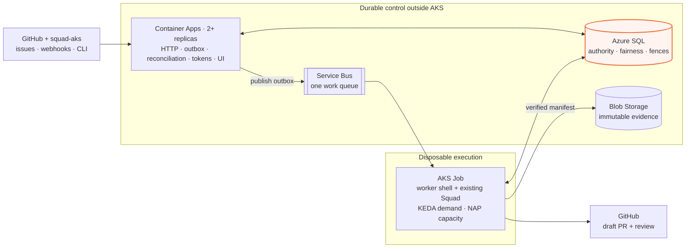
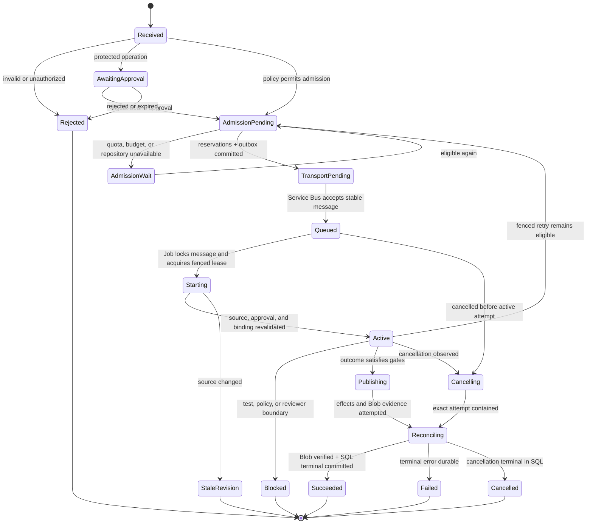

# Squad on AKS

**Run governed, event-driven AI engineering Squads as ephemeral Azure Kubernetes Service Jobs while durable Azure services preserve workflow state, approvals, effects, and evidence.**

Squad on AKS turns a GitHub request into a traceable unit of work. A durable .NET control application validates policy and commits the request, reservations, and an outbox record in one Azure SQL transaction. An outbox publisher places admitted work on one Azure Service Bus queue. Managed KEDA creates a short-lived AKS Job that hosts the existing Squad/Copilot runtime inside a small .NET worker shell. The Job produces a draft pull request or a governed evidence report, then disappears. Azure SQL remains authoritative, GitHub holds reviewable collaboration, and Azure Blob Storage preserves immutable evidence.

From a clean clone, a developer can authenticate and submit a deployment in **three manual steps and under five minutes of human interaction**. A new Azure environment normally takes **30-45 minutes** to provision asynchronously. Against an existing environment, the sample is ready to exercise in **about 10 minutes**.


```text
┌─ Remediation Flight Control ─────────────────────────────────────────────────┐
│ checkout-api #184 · HTTP dependency remediation              ACTIVE  06:41 │
│                                                                            │
│  ✓ Request accepted      ✓ Policy passed       ✓ AKS Job scheduled         │
│  ✓ Repository cloned     ● Running tests       ○ Publish draft PR          │
│                                                                            │
│  Squad: remediation@1.2.0        Attempt: sqa-01J9YQ7M8K                   │
│  Branch: squad/184-http-fix      Budget: $1.82 / $8.00                    │
│  Trace:  7b1c…e93                [Open evidence] [Request cancellation]    │
└────────────────────────────────────────────────────────────────────────────┘
```

> [!IMPORTANT]
> Squad is not rewritten in .NET, and this sample does not add deployment commands to the upstream Squad CLI. This repository ships its own `./squad-aks` deployment and operations CLI. Each AKS Job runs the existing Squad/Copilot runtime inside a small Azure/.NET worker shell that handles leases, identity, telemetry, cancellation, evidence, and process lifecycle.

## What you will build and see

The sample deploys a complete **Remediation Flight Control** scenario:

1. A GitHub issue, webhook, or repository-local CLI request reports work to be done.
2. The control application authenticates the caller, resolves the selected Squad configuration, and uses Azure SQL to admit work fairly. Request intent, concurrency and budget reservations, any repository write lease, and an outbox row are committed atomically.
3. An outbox publisher sends the immutable work envelope to one shared Service Bus queue using a stable message ID. Acknowledged queue demand becomes input to a managed KEDA `ScaledJob`.
4. AKS schedules an isolated Job. Node Auto-Provisioning (NAP) adds node capacity when the cluster does not already have a suitable node.
5. The .NET worker shell locks one message, acquires a fenced SQL attempt lease, materializes the exact repository revision, requests a repository-scoped GitHub App token, starts the existing Squad runtime, and streams correlated logs, traces, status, usage, and cost signals.
6. Squad investigates the repository, implements the remediation, validates it, and either opens one draft pull request or stops at a governed boundary with an evidence report.
7. The worker reconciles GitHub effects, writes and verifies an immutable Blob manifest, and commits terminal state in Azure SQL before settling the Service Bus message. Flight Control and the GitHub-native workflow show the same truthful result.

The completed experience includes:

- **GitHub-native entry points** for requests, status, approval, rejection, and cancellation. Flight Control is useful, but never required.
- **Flight Control** for operators who need queue state, active work, approvals, cancellation, evidence, cost, and reconciliation in one calm view.
- **Demand-driven execution** with managed KEDA Jobs and NAP-backed compute elasticity.
- **N logical Squads** selected from versioned configuration while sharing the same cluster, control plane, identity foundation, and observability stack.
- **Durable authority outside AKS** so rescheduling a pod, deleting a Job, or losing a node cannot invent, erase, or finalize business state.

## Minimum useful architecture

The sample keeps the workflow model to four concepts:

1. **AKS Automatic** runs disposable Jobs and supplies managed KEDA, Node Auto-Provisioning, and workload identity.
2. **Azure Service Bus** holds admitted work until a Job can claim it.
3. **Azure SQL** owns requests, fair admission, reservations, fenced leases, approvals, cancellation, effects, and terminal state.
4. **One .NET control application on Azure Container Apps** hosts admission/API/UI, outbox publishing, reconciliation, GitHub token issuance, and Flight Control.

Those concepts deploy as a fixed eight-resource-family baseline:

| Resource family | Baseline responsibility |
|---|---|
| Azure Container Apps | One horizontally replicated .NET control application; two minimum production replicas |
| Azure SQL | Business authority, transactional outbox, fairness, reservations, attempts, fences, effects, and terminal state |
| Azure Service Bus | One ordinary work queue plus dead-letter queue; transport for already-admitted runnable work |
| AKS Automatic | Disposable Jobs, managed KEDA demand activation, NAP capacity, and one fixed worker resource envelope |
| Azure Container Registry | Pinned control and worker images |
| Key Vault + managed identities | GitHub App private-key custody and workload identity |
| Application Insights + Log Analytics | Correlated operational telemetry, not the durable evidence record |
| Azure Blob Storage | Create-once, checksum-verified manifests and evidence, including no-PR outcomes |

This is the starting point, not a speculative production platform. New components belong only when a measured user, scale, security, or availability requirement cannot be met by this topology.

## Quickstart: clone to deployment submission in three steps

### Prerequisites

Use macOS, Linux, or Windows with WSL 2 and install:

- [Git](https://git-scm.com/downloads)
- [Azure CLI 2.76 or later](https://learn.microsoft.com/cli/azure/install-azure-cli)
- [GitHub CLI 2.78 or later](https://cli.github.com/)
- An Azure subscription where you can create a resource group and assign roles at that resource-group scope
- Permission to create a GitHub App in the target organization, or the ID and private-key secret for an existing compatible GitHub App

You do **not** need `kubectl`, Helm, Bicep, the .NET SDK, or Node.js for the standard deployment path. The repository's pinned dev container contains those tools for contributors.

### Authentication assumptions

`./squad-aks login` is the only interactive authentication command. It:

- opens Azure device-code or browser authentication through Azure CLI;
- lets you select the Azure tenant and subscription;
- runs `gh auth login --web` when GitHub CLI has no valid session;
- verifies that the GitHub identity can administer the selected organization or use the supplied GitHub App;
- stores only non-secret environment selection under `.squad-aks/local/`;
- places generated deployment secrets in Azure Key Vault, never in the repository or local configuration.

The signed-in user is used only for bootstrap. Running services use Microsoft Entra workload identities and the GitHub App installation identity. No long-lived Azure client secret or personal access token is created.

### 1. Clone

```bash
git clone https://github.com/bradygaster/squad-on-aks.git
cd squad-on-aks
```

Expected:

```text
Cloning into 'squad-on-aks'...
✓ repository ready
```

### 2. Log in and bootstrap local context

```bash
./squad-aks login --github-org YOUR_ORG --subscription YOUR_SUBSCRIPTION
```

Expected:

```text
✓ Azure identity          brady@example.com
✓ Tenant                  Contoso Engineering (72f9…db47)
✓ Subscription            AI Samples (3f2d…019a)
✓ GitHub identity         @bradygaster
✓ GitHub organization     YOUR_ORG
✓ Required providers      registered
✓ Local context           .squad-aks/local/default.json

Ready to deploy. No cloud resources have been created yet.
```

### 3. Submit the deployment

```bash
./squad-aks deploy --environment demo --location eastus2 --wait-ready
```

Within five minutes, the command validates configuration, creates the deployment record, and submits provisioning:

```text
Squad on AKS · demo · eastus2

✓ Configuration validated
✓ Deployment identity prepared
✓ Provisioning submitted       deployment: sqdep-01J9Y6A4P2
✓ Progress endpoint available  https://squad-demo.example.net/deployments/sqdep-01J9Y6A4P2

Human interaction complete in 02:37.
Provisioning continues asynchronously and usually takes 30-45 minutes.

  10:14:08  resource group       ready
  10:16:31  network              ready
  10:25:44  AKS control plane    ready
  10:31:17  worker capacity      ready
  10:35:52  data and messaging   ready
  10:40:06  durable control      ready
  10:43:19  KEDA execution path  verified
  10:43:41  sample request       ready

✓ Environment ready
Flight Control: https://squad-demo.example.net/
Run sample:     ./squad-aks run remediation --sample checkout-regression
```

`--wait-ready` streams progress but does not require attention. You can close the terminal after **Provisioning submitted** and later run `./squad-aks status --environment demo`.

If `demo` already exists, `deploy` performs an idempotent configuration and health reconciliation. That path usually reaches **Environment ready** in 5-10 minutes.

## What `squad-aks deploy` provisions

The deploy command executes the repository's signed, pinned infrastructure and application release:

| Area | Provisioned capability |
|---|---|
| Resource boundary | One Azure resource group per environment with consistent tags, expiration, and cost attribution |
| Execution | AKS Automatic with managed KEDA, NAP, workload identity, execution policy, and one fixed ephemeral Squad Job resource envelope |
| Control application | One .NET application on Azure Container Apps with two minimum production replicas, containing HTTP admission/API/UI, fairness dispatch, outbox publishing, reconciliation, GitHub token issuance, and Flight Control |
| Durable state | Azure SQL for requests, outbox, fair admission, reservations, attempts, fenced leases, transitions, approvals, cancellation, effects, evidence indexes, and terminal state |
| Messaging | One Azure Service Bus work queue and dead-letter queue with managed-identity access |
| Evidence | Azure Blob Storage with create-once objects, versioning, soft delete, checksum verification, and lifecycle retention |
| Supporting resources | Azure Container Registry, Key Vault and managed identities, Application Insights, and Log Analytics |
| Sample | Versioned remediation Squad configuration, deterministic fixtures, policy defaults, and an end-to-end smoke test |

The deployer prints every planned role assignment before applying it. Use `./squad-aks deploy --plan` to review changes without provisioning.

## First run: remediate a checkout regression

Start the included scenario after the environment reports ready:


```bash
./squad-aks run remediation \
  --environment demo \
  --sample checkout-regression \
  --repo YOUR_ORG/checkout-api
```

Expected:

```text
✓ Request accepted       request: sqr-01J9YQ4N3C
✓ Squad resolved         remediation@1.2.0
✓ Policy passed          repository allowlist, $8.00 budget, draft PR only
✓ Work queued            route: remediation

Follow:
  ./squad-aks run watch sqr-01J9YQ4N3C
  https://squad-demo.example.net/runs/sqr-01J9YQ4N3C
```

Watch the request move from durable intent to ephemeral compute:

```bash
./squad-aks run watch sqr-01J9YQ4N3C
```

```text
WAITING   10:51:02  Request, reservations, and outbox committed to Azure SQL
WAITING   10:51:03  Service Bus accepted message sqr-01J9YQ4N3C:1
WAITING   10:51:08  KEDA requested an execution Job
WAITING   10:51:11  NAP is adding compatible node capacity
ACTIVE    10:53:47  Attempt sqa-01J9YQ7M8K acquired SQL fence 4
ACTIVE    10:53:50  Existing Squad runtime started
ACTIVE    10:54:31  Repository materialized at 4d9e12a
ACTIVE    10:57:09  Regression reproduced
ACTIVE    11:00:42  Candidate fix implemented
ACTIVE    11:02:18  Validation passed: 183 tests
ACTIVE    11:03:04  Draft pull request recorded: YOUR_ORG/checkout-api#184
ACTIVE    11:03:06  Blob manifest verified: sha256:95a…d20
SUCCESS   11:03:07  Effects reconciled; SQL terminal state committed
SUCCESS   11:03:08  Service Bus message settled

✓ Completed in 12m 06s · compute $0.41 · model budget $2.36 / $8.00
```

The draft pull request contains the implementation, validation summary, request ID, trace link, and authorized evidence link. GitHub remains a complete interaction surface: a developer can request, follow, approve, reject, cancel, and review work without opening Flight Control.

## Remediation Flight Control

Flight Control is a projection of durable state, not a second scheduler and not an alternative source of truth.

### Deployment view

```text
Environment  demo / eastus2                                      HEALTHY

Control replicas  2 healthy     SQL authority       Connected
AKS execution     Ready         Service Bus         0 active / 0 dead-letter
KEDA              Ready         GitHub App          Installed in 12 repositories
NAP               Enabled       Blob evidence       Immutable policy active

Recent deployment events
  ✓ Infrastructure release 1.0.0 applied
  ✓ Worker image sha256:8c1…92e admitted
  ✓ Synthetic remediation completed in 03:14
```

### Queue and run states

| State shown | What it means | Operator action |
|---|---|---|
| **Waiting** | The request is durable but has no active lease. Flight Control names the reason: approval, class share, Squad concurrency, budget, repository writer, transport, capacity, or retry. Waiting does not imply queue depth. | Inspect the specific admission or execution constraint. |
| **Active** | One Job holds the current SQL lease and reports heartbeats. | Follow phases, logs, traces, budget, and evidence. |
| **Blocked** | Progress requires an explicit human decision or an external dependency. No approval is inferred. | Review evidence, approve, reject, provide input, or cancel. |
| **Cancellation requested** | Intent to stop is durable, but the matching Job has not acknowledged it. | Wait or inspect the active lease and worker heartbeat. |
| **Cancelling** | The worker acknowledged the request and is containing work. External effects may still require reconciliation. | Review cancellation evidence. |
| **Cancelled** | Work is contained, effects and evidence are reconciled, the lease is closed, and queue settlement is complete. | Open the terminal record. |
| **Succeeded** | Required validation, effects, evidence, and settlement are recorded. | Review the draft PR or report. |
| **Failed** | The terminal failure and available evidence are durable. | Retry from the recorded generation when policy permits. |

### Approval

When a Squad reaches a protected action, Flight Control shows the exact proposed effect:

```text
BLOCKED · Approval required

Request:       sqr-01J9YQ4N3C
Proposed:      Admit remediation and permit one draft pull request
Repository:    YOUR_ORG/checkout-api
Base revision: main @ 4d9e12a
Digest:        f31c…90aa
Policy:        draft-pr-approval
Expires:       on source, policy, or configuration change

[Approve and admit run] [Reject with reason]
```

Approval is optimistic, versioned, and digest-bound. If the source revision, Squad configuration, or policy changes, the previous approval cannot be reused.

### Truthful cancellation and reconciliation

Cancellation is deliberately not displayed as instantaneous:

```text
11:07:12  CANCELLATION_REQUESTED  Durable intent recorded
11:07:14  CANCELLING             Matching worker acknowledged
11:07:16  CANCELLING             Child work stopped; pod containment confirmed
11:07:19  CANCELLING             GitHub effects compared with effect journal
11:07:21  CANCELLING             Blob manifest verified; SQL terminal state committed
11:07:23  CANCELLED              Lease closed; reservations released; message settled
```

Deleting an AKS Job does not mark a run cancelled. If a Job disappears before acknowledging cancellation, the reconciler waits for lease expiry, inspects recorded effects, and either resumes containment in a new attempt or records a failed/uncertain outcome. Flight Control shows that uncertainty rather than inventing success.

## Multiple Squads, one platform

Squad definitions are versioned data. Adding a logical Squad does not create another AKS cluster, SQL database, Service Bus namespace, control plane, or observability stack.

The durable backlog stays in Azure SQL. Before work reaches the shared execution queue, the SQL dispatcher applies weighted fairness across workload classes and Squads, then atomically reserves global, trust-domain, and per-Squad concurrency; domain and Squad budget; and—when a run may mutate code—the single repository write lease shared across all Squads. The queue stays shallow and contains only runnable, already-admitted work. A noisy Squad can exhaust its own caps or budget without occupying the queue or starving another Squad.

The included remediation definition looks like this:

```yaml
apiVersion: squad.azure.dev/v1
kind: Squad
metadata:
  name: remediation
  version: 1.2.0
spec:
  runtime:
    image: ghcr.io/bradygaster/squad-runtime:1.2.0
    workloadClass: interactive
    timeout: 45m
  routing:
    domain: engineering
    route: remediation
    weight: 2
    maxActive: 2
    maxDispatchedNotStarted: 1
  repositories:
    allow:
      - YOUR_ORG/checkout-api
  policy:
    maxRunCostUsd: 8
    pullRequests: draft-only
    protectedEffects:
      - github.pull_request.create
  agents:
    - dependency-analyst
    - implementer
    - test-engineer
    - security-reviewer
```

Register another Squad from version-controlled configuration:

```bash
./squad-aks squad add platform-upgrade \
  --environment demo \
  --file squads/platform-upgrade/squad.yaml
```

```text
✓ Schema valid              squad.azure.dev/v1
✓ Policy valid              3 repositories, $12.00 maximum
✓ Runtime image admitted    sha256:601…d2b
✓ Configuration published   platform-upgrade@1.0.0
✓ Routing key ready         platform-upgrade

No infrastructure resources were cloned.
```

Select it explicitly:

```bash
./squad-aks run platform-upgrade \
  --environment demo \
  --repo YOUR_ORG/catalog-api \
  --request "Upgrade the service to the approved .NET release"
```

Requests capture an immutable Squad version. Updating `platform-upgrade` affects new requests only; active runs continue with the version they started with. The shared queue, SQL records, identities, quotas, and telemetry are logically partitioned by environment, Squad, repository, and request.

`interactive`, `standard`, and `batch` are admission, deadline, retry, and budget classes over the **same fixed CPU, memory, and ephemeral-storage Job template**. Their initial dispatch shares are 50%, 35%, and 15%; unused share may be borrowed, while weighted deficit round-robin and aging prevent starvation. A request that cannot fit the baseline worker envelope is rejected as `unsupported_workload_profile`; different pod shapes, queue-per-Squad, and namespace-per-Squad are advanced topology changes, not hidden baseline behavior.

## Architecture



The arrows do not assign authority. KEDA translates queue demand into Jobs, and NAP translates unschedulable pods into node capacity. **Azure SQL state, expected-version transitions, and `attempt_id + fence_token + unexpired lease` remain the business authority.** Blob stores durable evidence bytes; GitHub stores human collaboration; neither replaces SQL terminal truth.

Azure Container Registry, Key Vault and managed identities, Application Insights, and Log Analytics support this flow but are intentionally omitted from the diagram because they do not add workflow stages.

### Run lifecycle



### Admission, attempts, and crash recovery

The control application returns durable acceptance only after Azure SQL commits the normalized request and policy result. Fair scheduling later commits the concurrency, budget, and repository reservations together with one outbox row. Any control replica may claim that row and publish its immutable envelope using the stable message ID `<work_id>:<dispatch_generation>`. If the broker accepts a send but the publisher crashes before recording the acknowledgement, another replica safely resends the same message ID; SQL guards the logical run even if transport duplicate detection does not.

An AKS Job becomes authoritative only after SQL creates a unique attempt, increments the run's monotonically increasing fence token, and grants an unexpired lease. Every heartbeat, state transition, effect write, evidence selection, GitHub token issuance, and terminalization must match the current attempt and fence. Lease or message-lock loss stops new phases and external mutations immediately; a later delivery waits for lease expiry, acquires a higher fence, and reconciles the previous attempt before acting.

Terminal ordering is strict:

1. reconcile every planned, started, or uncertain external effect;
2. upload evidence using create-only Blob writes and verify every checksum;
3. select the terminal manifest and commit the outcome, released reservations, and settlement intent in Azure SQL;
4. only then complete or dead-letter the Service Bus message.

A crash after SQL terminalization but before queue settlement produces a harmless tombstone redelivery: the next receiver observes terminal SQL state, performs no Squad work, and settles the message. Completing the message before terminal persistence is forbidden.

### Evidence ownership

| Store | Owns | Does not own |
|---|---|---|
| Azure SQL | State, attempts and fences, approvals, cancellation, effect journal, evidence index and checksums, selected manifest, retention class, terminal result, and settlement intent | Large reports, raw source, complete logs, tokens, or private keys |
| GitHub | Reviewable collaboration: lifecycle status, Check Runs, concise validation, and an optional branch, commit, or draft PR | Private platform evidence or terminal business authority |
| Azure Blob Storage | Immutable normalized inputs, test reports, SARIF, patches, allow-listed diagnostics, cancellation proof, and the canonical terminal manifest | Tokens, keys, unrestricted prompts or model output, or mutable run state |

Blob objects use create-only names, versioning, soft delete, and SHA-256 verification. A selected manifest records each object's checksum, length, media type, schema version, producing attempt and fence, classification, and retention class; SQL stores the selected manifest URI and checksum. Raw signed webhook payloads default to seven days, normalized inputs to 30 days after terminal state, unselected orphan uploads to seven days, and selected standard evidence to **90 days in demo** or **365 days in production**. Committed immutable retention can be extended but not shortened.

No-PR runs are first-class. A blocked, failed, stale, cancelled, or report-only result may store a patch and evidence bundle in Blob, commit terminal truth in SQL, and publish a lifecycle comment or Check Run when GitHub is available without pushing a branch or opening a pull request. If GitHub is unavailable, SQL plus Blob are sufficient; delayed GitHub projection does not change the terminal result.

### Replica-safe control application

The baseline deploys one Container Apps application with **two minimum production replicas**. Every replica can serve HTTP admission, approval, cancellation, status, token issuance, and Flight Control, and can run the fairness dispatcher, outbox publisher, stale-attempt reconciler, effect reconciler, evidence reconciler, and GitHub projector.

There is no in-memory singleton authority, leader-only replica, Redis lock, or separate background-worker service. Background loops use expiring SQL claims; handlers are idempotent and safe to repeat. If one replica dies, another resumes expired claims. If SQL is unavailable, admission returns a retryable failure, token issuance fails closed, and active workers start no new effects after lease renewal fails.

### Durable records and invariants

The completed control application owns a compact relational contract: requests and transitions, approvals, outbox rows and observed deliveries, attempts, effects, evidence objects and terminal manifests, GitHub token-issuance metadata, Squad policies and dispatch accounts, concurrency/repository/budget reservations, usage charges, and expiring control-work claims.

Across those records:

- one logical run has at most one current attempt and fence;
- a terminal request never becomes nonterminal and selects a verified manifest except for rejection before evidence creation;
- no terminal settlement intent exists while an effect remains planned, started, or uncertain;
- no token is issued without the current attempt, fence, lease, Squad, and repository binding;
- no outbox row exists without committed reservations;
- only one mutation-capable run holds the repository writer reservation across all Squads;
- counters and usage events are idempotent, and mutable transitions use database time plus expected state and row versions.

## Operations

### Status and health

```bash
./squad-aks status --environment demo
```

```text
Environment demo · eastus2 · release 1.0.0
HEALTHY

Control API       healthy     SQL leases       0 stale
Dispatcher        healthy     Queue            0 active / 0 dead-letter
Reconciler        healthy     AKS Jobs         0 active
GitHub App        healthy     Last synthetic   success · 18m ago
```

Use `./squad-aks status --watch` during provisioning or an incident.

### Logs and traces

```bash
./squad-aks logs sqr-01J9YQ4N3C --follow
./squad-aks trace sqr-01J9YQ4N3C --open
```

Logs are structured and redacted before ingestion. Every control-plane operation, Service Bus delivery, SQL transition, AKS Job, GitHub effect, and evidence record carries the request ID, work ID, attempt ID, and W3C trace context.

For cluster-level investigation:

```bash
az aks command invoke \
  --resource-group rg-squad-demo-eastus2 \
  --name aks-squad-demo \
  --command "kubectl get jobs,pods -n squad-execution"
```

The standard path does not grant developers direct cluster credentials. `az aks command invoke` is audited and can be disabled in stricter environments.

### Cost

```bash
./squad-aks cost --environment demo --period 7d --group-by squad
```

```text
SQUAD               RUNS   COMPUTE   PLATFORM SHARE   MODEL*    TOTAL*
remediation            18     $6.82           $19.40   $38.16    $64.38
platform-upgrade        4     $2.11            $4.31   $11.02    $17.44

* Model cost is estimated from provider usage records and reconciled when final
  billing data becomes available.
```

The control application, Azure SQL, Service Bus, Blob Storage, registry, and telemetry have standing cost even when no Squad Job is running. Execution capacity scales with demand; NAP is not business authority and is not a scale-to-zero mechanism for the entire platform.

### Redeploy and upgrade

```bash
git pull --ff-only
./squad-aks deploy --environment demo --location eastus2 --wait-ready
```

Deployment is idempotent. The command shows the infrastructure and application plan, applies compatible database migrations before switching traffic, verifies the execution path with a synthetic run, and retains the previous application revision for rollback.

```bash
./squad-aks deploy --environment demo --release 1.0.0 --rollback
```

### Cleanup

```bash
./squad-aks destroy --environment demo --plan
./squad-aks destroy --environment demo --confirm demo
```

Destroy first disables new intake, drains or explicitly cancels active work, reconciles effects, exports the final evidence index, removes application and infrastructure resources, and verifies deletion. Key Vault soft-deleted secrets, Azure SQL backups, Blob immutability and retention, and Log Analytics retention follow the policies shown in the destroy plan and may outlive the resource group.

### Troubleshooting

| Symptom | Check | Resolution |
|---|---|---|
| Deployment remains on `AKS control plane` | `./squad-aks status --environment demo --deployment` | Confirm regional AKS quota and required resource providers; resume with the same `deploy` command. |
| Runs remain `Waiting: capacity` | `./squad-aks status --environment demo --capacity` | Review NAP constraints, regional VM availability, subscription vCPU quota, and the Squad workload class. |
| Runs remain `Waiting: admission` | `./squad-aks run inspect REQUEST_ID --admission` | Check workload-class share, per-Squad caps, budget reservation, repository writer, approval, and circuit state. |
| Runs remain `Waiting: transport` | `./squad-aks status --environment demo --transport` | Check outbox claims and Service Bus health; do not resubmit the request with a new identity. |
| Job restarts after node loss | `./squad-aks run inspect REQUEST_ID --leases` | Normally no action. The SQL lease and effect journal prevent an unrecorded takeover. |
| GitHub effect is uncertain | `./squad-aks run reconcile REQUEST_ID` | The reconciler queries GitHub by idempotency marker before retrying or finalizing. |
| Evidence cannot be selected | `./squad-aks run inspect REQUEST_ID --evidence` | Verify Blob availability, object checksum, manifest binding, and retention policy; the queue message remains unsettled. |
| Cancellation does not finish | `./squad-aks run inspect REQUEST_ID --cancellation` | Inspect worker heartbeat, lease expiry, exact-attempt containment, and unresolved effects; do not delete the Job as a substitute for reconciliation. |
| No telemetry appears | `./squad-aks doctor --environment demo --check observability` | Validate managed identity, ingestion endpoints, sampling policy, and workspace retention. |
| Authentication fails | `./squad-aks login --reset` | Reauthenticate to the intended tenant, subscription, and GitHub organization. |

Run `./squad-aks doctor --environment demo` for a read-only platform, identity, networking, GitHub, data, queue, execution, and telemetry diagnostic.

## Security and identity

- **Microsoft Entra workload identity** authenticates AKS Jobs and control services to Azure. There are no application client secrets.
- **Distinct managed identities** separate deployment, the control application, KEDA, and worker execution permissions. The shared queue uses one worker identity per environment and trust tier; Squad and repository authorization is enforced by the control API, not by per-Squad Kubernetes identities.
- **The worker identity is deliberately narrow.** It can receive shared-queue work, call the control API, and emit telemetry, but has no GitHub App private-key access and no unrestricted direct SQL or Blob authority.
- **The GitHub App private key and webhook secret** remain in Key Vault. Only the control application's managed identity can read the private key; it never reaches AKS workers, SQL, Service Bus, Blob, logs, or evidence.
- **GitHub App installation tokens are minted per attempt and repository.** Before issuance, the control application checks the worker identity, current attempt and fence, unexpired SQL lease, dispatch generation, Squad-to-repository binding, installation membership, requested permissions, approval, cancellation, and issuance limits.
- **Token bytes are never persisted.** The worker keeps the repository-narrowed token only in memory or pod-local `tmpfs`. Refresh is denied immediately after lease loss, cancellation, installation removal, or authority revocation. The worker revokes best-effort on exit and otherwise relies on GitHub's provider-controlled expiry of up to one hour.
- **Repository allowlists and immutable Squad versions** are evaluated before work is queued.
- **Fenced Azure SQL leases and optimistic concurrency** prevent two Jobs from simultaneously owning one request or mutable Squad state partition.
- **The effect journal** records intent before every GitHub mutation using stable branch, commit, pull request, comment, or Check Run identities. A lost or timed-out provider response becomes `uncertain`; the reconciler queries GitHub and confirms, retries only when absent, or records a conflict instead of blindly repeating the effect.
- **Network policy** limits worker traffic in the sample.
- **Secrets are references**, resolved just in time from Key Vault and filtered from logs, traces, evidence, and model context.
- **Admission policy** permits only pinned runtime images, approved identities, resource limits, and supported Job templates.
- **Human approvals are versioned** and apply to a specific proposed effect, not to a mutable run in general.
- **Audit and evidence are append-oriented** and correlated from request through terminal settlement.

### Explicit non-goals

Squad on AKS does not:

- replace Squad or reimplement its agent runtime in .NET;
- use Kubernetes, KEDA, NAP, pod state, or queue depth as business authority;
- use queue-per-Squad or namespace-per-Squad as the fairness model;
- promise instantaneous or guaranteed cancellation of in-flight external effects;
- make Flight Control mandatory for GitHub-native workflows;
- create an AKS cluster or full service stack per logical Squad;
- provide arbitrary hostile multi-tenant code execution inside one shared cluster;
- silently choose larger worker shapes when work exceeds the fixed baseline resource envelope;
- merge pull requests or deploy generated changes to production by default;
- eliminate standing Azure platform cost;
- treat model-generated output as trusted without validation and policy checks;
- make preview Azure or Kubernetes features mandatory for the baseline.

## Repository layout

```text
.
├── README.md                         # This guide
├── squad-aks                         # Repository-local deployment and operations CLI
├── .devcontainer/                    # Pinned development toolchain
├── .github/
│   ├── workflows/                    # Build, scan, integration, release, and docs checks
│   └── dependabot.yml
├── cli/                              # squad-aks command implementation
├── deploy/
│   ├── bicep/                        # Azure infrastructure modules and environment entry point
│   ├── helm/                         # KEDA Job templates and AKS policies
│   └── releases/                     # Signed application release manifests
├── src/
│   ├── Squad.Control/                # Admission, dispatch, token brokering, reconciliation, and API
│   ├── Squad.Worker/                 # .NET lifecycle shell around existing Squad
│   └── Squad.FlightControl/          # Optional operator web experience
├── squads/
│   ├── remediation/                  # Finished remediation Squad definition
│   └── platform-upgrade/             # Example second logical Squad
├── samples/
│   ├── checkout-regression/          # Reproducible first-run request
│   ├── inventory-contract-block/     # Governed no-PR outcome
│   ├── storefront-approval/          # Pre-compute approval outcome
│   └── github-app/                   # GitHub App manifest and installation guide
├── tests/
│   ├── unit/
│   ├── integration/
│   ├── contract/
│   └── end-to-end/
└── docs/
    ├── operations/
    ├── security/
    └── architecture/
```

## Architecture decisions and tradeoffs

### Why AKS

Squad work is container-native, bursty, long-running, and benefits from strong per-Job resource, identity, network, scheduling, and optional sandbox boundaries. AKS provides a first-class Kubernetes Job model, managed KEDA demand activation, NAP-backed capacity, workload classes, policy controls, and direct operational visibility. The tradeoff is a larger platform surface and more standing cost than a serverless-only design.

The sample uses AKS Automatic to minimize cluster setup while retaining managed KEDA, NAP, workload identity, and Kubernetes Job semantics. AKS Standard is an extension point only when a documented workload requirement needs lower-level cluster control.

### Why the .NET host boundary

Azure SDKs, OpenTelemetry, managed identity, health checks, durable retries, and lifecycle coordination are mature and consistent in .NET. The shell owns Azure integration and process supervision while the existing Squad runtime remains unchanged. This keeps the boundary narrow: .NET does not absorb agent behavior, prompts, routing, or orchestration semantics.

### Why Azure SQL and Service Bus

Azure SQL provides transactions, optimistic concurrency, fenced leases, fair admission, repository and budget reservations, a transactional outbox, relational audit queries, and an authoritative effect journal. Service Bus provides efficient delivery, backpressure, PeekLock renewal, duplicate detection, and dead-lettering from one shared work queue that KEDA can scale from. SQL owns the backlog; the queue contains a shallow window of already-admitted runnable work. A queue message is a delivery hint, and SQL state decides whether a Job may act. This intentionally duplicates a small amount of coordination data to avoid pretending a queue is a workflow database.

### Why Blob Storage

SQL is the right place for state and checksums, but not for large test reports, patches, SARIF, cancellation proof, and complete terminal manifests. GitHub is the right collaboration surface, but it is neither a private evidence store nor a guaranteed destination for no-PR runs. Blob Storage therefore provides create-once, retention-controlled evidence bytes while SQL selects and authorizes the canonical manifest.

### Why one replicated control application

Admission, outbox publishing, fairness, reconciliation, token issuance, API/UI, and Flight Control share one deployment boundary because their correctness already converges on Azure SQL. Two minimum production replicas provide HTTP and background-work availability without inventing separate services. Expiring SQL claims and idempotent handlers replace singleton process authority.

### Why control-plane authority remains outside AKS

Execution Jobs are disposable by design. Nodes can disappear, pods can be evicted, Jobs can be retried, and operators can make Kubernetes changes. Durable state, approvals, cancellation intent, effect reconciliation, and evidence therefore live in managed services and a separately hosted control plane. AKS reports execution facts; it does not declare business truth.

## Done means this works end to end

The sample is complete when all of the following are continuously verified:

- A first-time user can clone, authenticate/bootstrap, and submit deployment in three manual steps and under five minutes of human interaction.
- Provisioning continues asynchronously with observable, resumable progress and no requirement to keep a terminal open.
- A pre-provisioned environment becomes ready for a sample run in roughly 10 minutes.
- `squad-aks deploy` creates the documented eight resource families: replicated Container Apps control, SQL, Service Bus plus DLQ, AKS Automatic with managed KEDA and NAP, registry, Key Vault plus identities, observability, and Blob evidence.
- A GitHub or repository-local CLI request is durably accepted in SQL, and reservations plus its outbox row commit atomically before execution is requested.
- Killing an outbox publisher after broker acceptance but before its SQL acknowledgement produces one logical run through stable message IDs and safe resend.
- KEDA creates an ephemeral AKS Job from Service Bus demand, and NAP supplies compatible capacity when needed.
- The Job locks one message, acquires and renews a fenced Azure SQL attempt lease, materializes the exact source revision, and runs the existing Squad runtime inside the .NET worker shell.
- Lease loss blocks token refresh and new effects; a higher-fence takeover reconciles prior effects before acting.
- GitHub App private-key material never leaves Key Vault and the control application; workers receive only per-attempt, repository-narrowed tokens that are absent from durable stores, logs, Git configuration, process arguments, and evidence.
- A lost GitHub response is reconciled by stable effect identity and cannot create a second branch, pull request, lifecycle comment, or Check Run.
- The successful remediation scenario reproduces a failure, implements and validates a fix, opens exactly one draft pull request, verifies the Blob manifest checksum, commits SQL terminal state, and only then settles Service Bus.
- The contract-block scenario publishes immutable Blob evidence and SQL terminal truth without pushing a code branch or opening a pull request.
- The elevated-risk scenario consumes no worker capacity until a valid digest-bound approval is durable.
- GitHub provides a complete path to request, follow, approve, reject, cancel, and review work without Flight Control.
- Flight Control accurately shows Waiting, Active, Blocked, approval, cancellation, reconciliation, Success, Failure, and Cancelled states.
- A killed, duplicated, stale, or redelivered Job cannot create concurrent authority or repeat a recorded external effect.
- Cancellation is terminal only after acknowledgement when applicable, exact-attempt containment, effect reconciliation, Blob evidence verification, SQL terminalization, lease closure, and queue settlement.
- A crash after Blob upload leaves an orphan that cannot terminalize the run; a crash after SQL terminalization yields a no-work tombstone redelivery.
- Two control replicas accept a duplicate webhook once, recover expired outbox and reconciliation claims after replica death, and never depend on in-memory singleton state.
- A second versioned Squad can be added and selected without cloning platform infrastructure, and weighted fairness, per-Squad caps, budget reservations, and the cross-Squad repository write lease prevent noisy-neighbor starvation or conflicting writers.
- Interactive, standard, and batch admission classes share one fixed worker envelope; oversized work is rejected rather than silently creating a new Job shape or queue.
- Status, logs, traces, cost attribution, redeploy, rollback, diagnostics, and cleanup behave as documented.
- Automated tests exercise state transitions, outbox crash windows, fenced takeover, lock renewal/loss, tombstone redelivery, Blob checksum and immutability, no-PR reconstruction, token binding and expiry, ambiguous GitHub effects, replica takeover, fairness and budget isolation, repository writer exclusion, cancellation races, dead-letter handling, and the full deployment smoke path.

## Authoritative platform documentation

- [Azure Kubernetes Service documentation](https://learn.microsoft.com/azure/aks/)
- [AKS Automatic](https://learn.microsoft.com/azure/aks/intro-aks-automatic)
- [AKS Workload Identity](https://learn.microsoft.com/azure/aks/workload-identity-overview)
- [AKS Node Auto-Provisioning](https://learn.microsoft.com/azure/aks/node-auto-provisioning)
- [Managed KEDA on AKS](https://learn.microsoft.com/azure/aks/keda-about)
- [KEDA ScaledJob specification](https://keda.sh/docs/latest/reference/scaledjob-spec/)
- [KEDA Azure Service Bus scaler](https://keda.sh/docs/latest/scalers/azure-service-bus/)
- [Azure Service Bus locks and settlement](https://learn.microsoft.com/azure/service-bus-messaging/message-transfers-locks-settlement)
- [Azure SQL documentation](https://learn.microsoft.com/azure/azure-sql/)
- [Azure Blob Storage documentation](https://learn.microsoft.com/azure/storage/blobs/)
- [Azure Blob immutable storage](https://learn.microsoft.com/azure/storage/blobs/immutable-storage-overview)
- [Azure Monitor OpenTelemetry](https://learn.microsoft.com/azure/azure-monitor/app/opentelemetry-enable)
- [Microsoft Entra workload identities](https://learn.microsoft.com/entra/workload-id/workload-identities-overview)
- [GitHub App installation authentication](https://docs.github.com/apps/creating-github-apps/authenticating-with-a-github-app/authenticating-as-a-github-app-installation)
- [GitHub webhook best practices](https://docs.github.com/webhooks/using-webhooks/best-practices-for-using-webhooks)

---

Squad on AKS is a goal-first reference implementation: the interfaces in this README define the product contract. Infrastructure, durable control-plane behavior, worker lifecycle, Flight Control, fixtures, and tests ship together so the documented path is the path the sample continuously proves.
