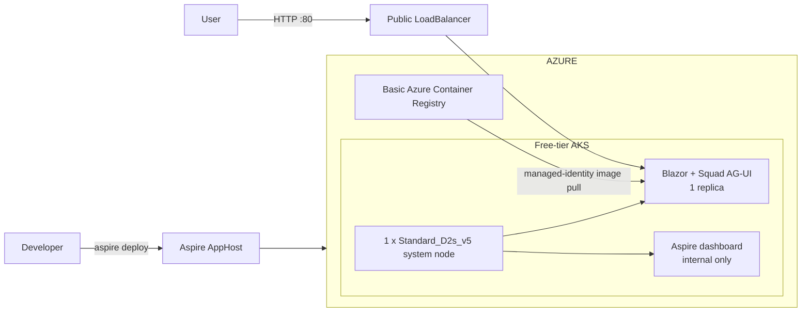

# Squad on AKS

**An Aspire-owned Blazor application with an in-process Squad AG-UI boundary,
health and OpenTelemetry defaults, and a proven AKS deployment topology.**

Daydream provides the Blazor host, direct `Squad.Agents.AI` registration,
`/ag-ui` streaming, native casting, persistent work waves, and app-owned
Kubernetes deployment workers. The local eight-ball proof builds and serves
React plus ASP.NET Core through a real worker and app-owned Aspire chart.
This does not close the outstanding AKS and first-user acceptance gates.

The current implementation proves the deployment foundation for
[Wave 1](https://github.com/bradygaster/squad-on-aks/issues/3):

- a C# Aspire AppHost is the local and deployment source of truth;
- the Aspire `app` resource runs the ASP.NET Core Blazor Web App;
- the same process hosts the `Squad.Agents.AI` agent and `/ag-ui` endpoint;
- native Init Mode proposes and refines a cast without writing roster files;
- explicit confirmation generates Squad-owned team, routing, charter, history,
  and casting-state files;
- Cast review limits edits to `team.md`, `routing.md`, and active charters,
  validates the native shape, and gates activation;
- Aspire ServiceDefaults provides health and OpenTelemetry wiring;
- Aspire provisions AKS and Azure Container Registry;
- AKS has exactly one fixed, non-autoscaling system node;
- the application runs as one replica on that system node;
- the application is exposed through a public `LoadBalancer` Service;
- the Aspire dashboard remains an internal `ClusterIP` Service;
- a Kubernetes Secret carries the modeled Copilot parameter;
- application startup seeds an isolated disposable Git workspace;
- health probes and explicit resource budgets are applied; and
- `aspire destroy` removes both the Helm release and Azure resource group.

## Current architecture



The application exposes:

| Endpoint | Expected response |
|---|---|
| `GET /` | Native casting and cast-review user experience |
| `POST /ag-ui` | Streaming AG-UI server backed by `Squad.Agents.AI` |
| `GET /diagnostics/workspace` | Disposable fixture state, test command, expected changed files, and native harness files |
| `GET /casting/status` | `Needs cast`, `Cast review`, or activated `Ready` state |
| `GET /casting/review` | Native review allowlist and Markdown content after confirmation |
| `PUT /casting/review` | Save an allowlisted native Markdown review edit |
| `POST /casting/activate` | Validate the native cast and unlock work controls |
| `GET /health/live` | HTTP 200 |
| `GET /health/ready` | HTTP 200 |

### Daydream app library

`GET /apps` lists the library and `POST /apps` starts a fresh app. Each entry has
a stable ID. `POST /apps/{id}/select` validates a selection; selection is carried
in the page URL (`?app={id}`), not in shared server state, so different tabs can
work on different apps. The existing `/ag-ui`, `/casting/*`, `/work/*`, `/waves`,
`/workspace/*`, and `/publish` routes are available below `/apps/{id}`. Unprefixed
routes remain aliases for the original app.

Each app owns its squad, lifecycle, conversation sessions, evidence, waves,
download and publication services. The original workspace is retained; the
library registry and additional app workspaces live beneath its `.git` directory
and are excluded from app exports. Titles, activation and wave histories resume
independently after restart. On the separate preview listener, `/apps/{id}/`
serves only that app's generated static site; it never exposes Daydream's APIs.
Generated sites should use document-relative links and assets.

Initialization validates an exact copy of the packaged template. Ongoing readiness
checks workspace and Git-directory presence, the configured production runtime
boundary, and shutdown state instead of comparing mutable files with the template.
Casting and application edits therefore do not invalidate readiness. Unhealthy
readiness returns HTTP 503 with an empty body, not the UI not-found page; liveness
remains independent.

## Production container reset proof

Run the local prerequisite gate with Docker available:

```bash
scripts/run-container-reset-tests.sh
```

The gate builds the `production` image, starts two sequential non-root
containers with read-only root filesystems and separate disposable `/workspace`
mounts, and drives casting, activation, work, evidence, readiness, redaction,
and shutdown through HTTP. It uses the disabled-by-default
`SQUAD_CONTAINER_PROBE_MODE` deterministic agent, so normal CI does not require
live model access. On failure, redacted container diagnostics are written under
`artifacts/container-tests/`.

The production image separately packages the official standalone
[Copilot CLI 1.0.103 release](https://github.com/github/copilot-cli/releases/tag/v1.0.103)
for Linux x64/ARM64, verifying the archive against pinned release SHA256 values.
Squad launches the full CLI with `--agent squad`; the SDK's bundled
`copilot-runtime` wrapper does not support that argument and is not used as
the production entrypoint. The container gate invokes the real packaged
`--version` and `--agent squad --help` commands without model access. These
checks prove CLI packaging/argument support, not a real-model conversation;
that remains the opt-in live browser acceptance gate in #17.

If Docker cannot reach the configured NuGet source, set
`SQUAD_CONTAINER_TEST_SDK_IMAGE` to an approved derivative of the pinned SDK
image that contains the locked global package cache; the final runtime stage
and all container assertions remain unchanged.

## Local Kubernetes eight-ball proof

The bounded local target is Docker Desktop Kubernetes, not Azure. Daydream's
workspace uses a retained PVC. The original workspace remains at
`/workspace/fixture`; the eight-ball template uses `/workspace/eight-ball`.
Each generated app has its own Squad and namespace. Production uses **one API
image containing the built React assets**, not two production services.

The worker image in `src/SquadOnAks.Worker` contains pinned .NET, Node, Aspire,
Helm, and runtime-image inputs plus offline dependency caches. Build it from
the repository root:

```bash
npm config set registry "https://packagefeedproxy.microsoft.io/npm/"
test "$(npm config get registry)" = 'https://packagefeedproxy.microsoft.io/npm/'
docker build -f src/SquadOnAks.Worker/Dockerfile \
  --build-arg NUGET_SOURCE=https://packagefeedproxy.microsoft.io/nuget/v3/index.json \
  --build-arg NPM_REGISTRY=https://packagefeedproxy.microsoft.io/npm/ \
  -t localhost:5057/daydream-worker:local-proof .
docker push localhost:5057/daydream-worker:local-proof
```

The existing local proof registry is `daydream-proof-registry`, published only
on `127.0.0.1:5057`, and attached to the node's Docker `kind` network. This
installation's node maps `localhost:5057` pulls to Docker network alias
`squad-on-aks-registry-w13:5000` through containerd's registry hosts configuration.
That node-side mapping is a prerequisite; `localhost` inside a node or pod is
not the Mac's loopback interface. The registry is unauthenticated and is for
this disposable local proof only.

Deploy through the pinned repository Aspire CLI. Select the registry-qualified
digest printed by the push, not an unqualified local image name:

```bash
export Parameters__deployment_target=docker-desktop
export Parameters__workspace_template=eight-ball
export Parameters__registry_endpoint=localhost:5057
export Parameters__worker_image="localhost:5057/daydream-worker@sha256:<digest-from-push>"
export Parameters__copilot_token="$(gh auth token)"
export DAYDREAM_REGISTRY_PUSH="$(docker inspect daydream-proof-registry \
  --format '{{(index .NetworkSettings.Networks "kind").IPAddress}}'):5000"
export DAYDREAM_NUGET_SOURCE=https://packagefeedproxy.microsoft.io/nuget/v3/index.json
dotnet aspire deploy --environment LocalKubernetes --clear-cache --non-interactive
kubectl --context docker-desktop -n default port-forward \
  --address 127.0.0.1 service/app-service 58080:80
```

Open **http://127.0.0.1:58080/**. `--clear-cache` is intentional when changing
deployment inputs: this Aspire version otherwise reuses saved parameter values,
including an older worker digest. It does not erase the PVC or app history.
Port-forward again after replacing the Daydream pod. The Aspire dashboard
stays internal and requires a separate, manually requested port-forward.

Cast the Squad, submit a small wave, then use **Put it online** or **Update your
online app**. An explicit update builds a new revision of the same app-owned
release; a readiness GET never starts work. The eight-ball app is available at
`/online/first/` only after frontend and API probes pass.
`GET /workspace/deployments` retains failed and successful revisions.

Build and validation jobs run without a Kubernetes token and with read-only
source mounts. Deployment jobs receive only an app-scoped deploy identity.
The separate trusted provisioner owns namespace/RBAC creation; Kubernetes
requires unscoped `create`/`escalate` authorization to create a Role, while
read/update/bind operations stay name-restricted. Generated namespaces enforce
restricted Pod Security. Their declared NetworkPolicies are **not a verified
hostile-code boundary on Docker Desktop's kindnet**. A separate
`docker --network none` build proves offline operation, not CNI enforcement.

`sh tests/run.sh` in the packaged eight-ball workspace builds React, builds the
API, and checks its readiness and answer contract in the tokenless worker.
The native Squad harness is shared from the packaged starter template.
AppHost dependency restore unlocks the OS-specific implicit Aspire packages
when moving the macOS lock file to Linux; top-level package versions remain
pinned. This worker supports this fixed fixture and local registry topology,
not arbitrary generated architectures or production registry authentication.

Recorded local acceptance, including both real Squad waves and build-stage
restart/retry recovery, is in
[the acceptance evidence](docs/evidence/local-kubernetes-acceptance.json).

## Run locally

Install the .NET SDK pinned in `global.json` and a Docker-compatible runtime
before starting. From the repository root, restore the pinned Aspire tool:

```bash
dotnet --version
dotnet tool restore
dotnet aspire --version
```

The expected SDK is `10.0.301` and Aspire CLI is `13.4.3`. Use `dotnet aspire`
to select the repository tool; a bare `aspire` can select a different global
installation.

Set the required Aspire parameters, start the isolated AppHost, and wait for
the single web resource. Setting the inputs and opening the URL are manual
actions; startup/build and the health wait run asynchronously:

```bash
export Parameters__copilot_token="<copilot-supported-token>"
export Parameters__workspace_path="${TMPDIR:-/tmp}/squad-on-aks-fixture"

dotnet aspire start --isolated --non-interactive
dotnet aspire wait app --non-interactive
dotnet aspire describe --format Json --non-interactive
```

Open the `http` URL for `app` from `dotnet aspire describe`; the initial page
shows **Needs cast**. Stop the isolated AppHost when done:

```bash
dotnet aspire stop --non-interactive
```

Both parameters are required. The web process fails at startup with an explicit
configuration error when either value is empty. The first start initializes the
configured workspace from the packaged template; later starts resume its saved
library, squads and waves. The packaged source is never mutated, no `.squad` directory is copied,
the writable copy is initialized as its own Git repository, and the diagnostics
endpoint initially reports `Needs cast`.

Do not point `Parameters__workspace_path` at the repository checkout or another
directory containing the packaged fixture source. Source and workspace paths
must be separate so reset can safely remain deterministic.

### Build an app in waves locally

To have a Squad build a new app from a nearly empty repository instead of the
`route-planner` remediation fixture, select the `starter` template. Locally,
the Copilot token parameter is also passed to the app as `GITHUB_TOKEN`, so use
a token that can create repositories if you want to publish:

```bash
export Parameters__copilot_token="$(gh auth token)"
export Parameters__workspace_path="${TMPDIR:-/tmp}/squad-on-aks-app"
export Parameters__workspace_template="starter"
dotnet aspire start --isolated --non-interactive
```

The `app` resource exposes two endpoints: `http` (Squad on AKS) and `preview`
(the generated app served from the workspace root, or from `public/`, `app/`,
`src/`, `dist/`, `web/`, or `site/`).

1. **Cast.** Describe the app, refine the proposal, then confirm. While casting,
   the server tells Squad to write only `.squad/` team files, so no project code
   is created before the first wave. After activation, setup shows the original
   intent as read-only context, with **View team files in Artifacts** opening
   the existing rendered file viewer rather than duplicating an editor.
   Empty cast conversations are hidden; nonempty conversations remain accessible.
   **Next wave** is the request editor. Casting/reconfirmation and review edits are rejected once
   the Squad is active, including after failed or cancelled work.
2. **Waves.** After you start taking requests, each request becomes a
   persistent wave. A wave records its objective, the specialists involved,
   live evidence, the application and team changes (diffs taken from per-wave
   commits), the `tests/run.sh` result, a duration, and an outcome. Completed
   waves stay in the **Waves** list so you can reopen them. Counted disclosure
   sections reveal validation, application changes, specialist activity, and
   team changes; empty categories stay hidden. Application changes use file
   tabs and one inline, colorized historical diff pane, with Added/Modified
   state retained. These diffs come from the selected wave's evidence, never
   the latest artifact contents. Team diffs and command output expand on demand.
   A compact live summary shows the latest reported specialist, assignment, and
   event time without opening detailed evidence. Adjacent identical activity
   events update one presentation row with a repeat count and an active spinner;
   the underlying evidence remains intact. Spinners stop at activity boundaries
   and terminal wave outcomes and respect reduced motion.
3. **Artifacts.** The top-level **Artifacts** tab browses every workspace file. Code shows
   line numbers and lightweight safe token colors (shared with historical diffs),
   Markdown renders, and images display inline. **Open app** opens
   the preview endpoint, **Download ZIP** exports the workspace, and
   **Publish to GitHub** reviews the destination account/organization and
   repository name before creating a new **private-only** repository and
   pushing the full wave-by-wave commit history, including Squad team/configuration
   files. Before creating a remote, publishing scans every commit for credential
   content and Squad/Copilot runtime paths; tainted history is blocked with
   remediation guidance and commit SHAs are never rewritten. Publishing uses
   the server-configured credential, not an independent browser authorization
   flow. The form identifies that credential's account; organization choices
   are subject to GitHub creation permissions.
   If creation succeeds but publication fails, the result includes the created
   repository link. Retry with the same destination name to resume publication
   to that private repository; the workspace-local retry record prevents a
   replacement repository from being created. This retry record does not
   survive workspace or pod replacement.
   Switching between **Work** and **Artifacts** preserves the selected wave,
   disclosure choices, and ongoing streaming; **View team files in Artifacts**
   selects the rendered team file and moves keyboard focus to the viewer.

ZIP export keeps at most 64 KiB in its memory spool, spills larger archives to
temporary disk, and rejects archives exceeding 2 GiB. The completed spool is
copied asynchronously to the response and deleted on disposal. Publication and
agent turns share exclusive workspace admission. Generated validation has a
two-minute execution limit; cancellation/failure cleanup checkpoints without
rerunning validation and is bounded to ten seconds (plus subprocess reaping).

ZIP downloads contain current workspace and Squad team/configuration files,
without Git history, `.git`, `node_modules`, symbolic links, or private Squad
runtime state. **Open app** opens the generated static preview in a new tab;
it does not deploy the application.

For local UI iteration, CSS and JavaScript changes are refresh-visible without
restarting the app or rerunning a wave. Razor markup and server-code changes
require a rebuild/reload unless hot reload is explicitly enabled. Each app's wave
timeline, title and activated squad are saved under its private `.git` metadata
and resume when Daydream restarts against the same workspace path. Cast conversation
history is stored separately per app in the browser session and restored only
when that app's generation matches. An explicit workspace reset discards that
app's old browser context; an ordinary restart does not. Storage remains
ephemeral when the hosting environment replaces the entire workspace volume.
The exact original casting intent is stored
server-side in the standalone workspace's private `.git/squad-original-intent.json`
metadata, before the server's casting guard is appended. Fresh browsers retrieve
only that text through `GET /casting/intent` (`Cache-Control: no-store`).
For older workspaces, the endpoint recovers the first user event from a uniquely
identified native casting session, strips only the known injected suffix, and
saves the recovered intent. Missing, malformed, unsafe, or ambiguous histories
return explicit errors rather than substituting a generated team summary.
Neither intent metadata nor native runtime logs are exposed as artifacts or
included in ZIP downloads or GitHub pushes. This metadata survives server
recreation with the same workspace, not a destructive workspace reset. Linked
Git worktrees are not supported as runtime fixture workspaces.

Squad runtime state (`.squad/session-state/` and `.squad/session-store.db*`) is
git-excluded and hidden from artifacts, ZIP downloads, and published
repositories.

| Endpoint | Purpose |
|---|---|
| `GET /waves`, `GET /waves/{number}` | Wave timeline and per-wave evidence |
| `GET /workspace/files`, `GET /workspace/file?path=`, `GET /workspace/raw?path=` | Artifact listing, file content, and raw files such as images |
| `GET /workspace/export.zip` | ZIP download of the workspace |
| `GET /workspace/preview` | Preview URL for the generated app, when it has an `index.html` |
| `GET /publish/owners`, `POST /publish` | Account and organization choices, then publish to a new GitHub repository |

## Deploy to Docker Desktop Kubernetes (opt-in)

The AppHost can target an existing Docker Desktop Kubernetes cluster for local
deployment. This is opt-in; omitting the target selector continues to use the
existing Azure AKS deployment. The local target does not provision Azure
resources. Aspire publishes the same application image to the configured
registry, and Kubernetes pulls it from that registry. The Docker Desktop
image build matches the local ARM64 or x64 host; the AKS image build is unchanged.

Enable Kubernetes from Docker Desktop's **Kubernetes** view by selecting
**Create cluster** ([Docker Desktop Kubernetes instructions](https://docs.docker.com/desktop/use-desktop/kubernetes/)).
Aspire uses its [existing-cluster Kubernetes target](https://aspire.dev/deployment/kubernetes/clusters/).
Install or provide `kubectl` and Helm 4.2.0 or later (Docker Desktop may
install `kubectl` on macOS, but the CLI must be on `PATH`). Before deploying,
confirm the cluster is ready and the active context is exactly `docker-desktop`:

```bash
kubectl config current-context
kubectl get nodes
```

If needed, select the Docker Desktop context explicitly, then recheck it:

```bash
kubectl config use-context docker-desktop
kubectl config current-context
```

Provide a container registry endpoint reachable from both the host (for image
pushes) and Docker Desktop Kubernetes nodes (for image pulls). For Docker
Desktop's **kind** provisioner, the verified local setup follows the
[kind local-registry guidance](https://kind.sigs.k8s.io/docs/user/local-registry/).
It adds one registry-specific containerd host mapping to the existing node,
without recreating the cluster or changing global Docker daemon configuration:

```bash
docker run --detach --name squad-on-aks-registry-w13 \
  --publish 127.0.0.1:5057:5000 --network kind registry:3
curl --fail http://127.0.0.1:5057/v2/

node="$(kubectl get nodes -o jsonpath='{.items[0].metadata.name}')"
docker exec "$node" mkdir -p /etc/containerd/certs.d/localhost:5057
printf '[host."http://squad-on-aks-registry-w13:5000"]\n  capabilities = ["pull", "resolve"]\n' \
  | docker exec --interactive "$node" sh -c \
    'cat > /etc/containerd/certs.d/localhost:5057/hosts.toml'

docker tag registry:3 localhost:5057/registry-probe:w13
docker push localhost:5057/registry-probe:w13
docker exec "$node" crictl pull localhost:5057/registry-probe:w13
```

Use an unused host port and registry name, and do not overwrite an existing
node registry mapping. Both the push and node pull must pass before deploying.
This setup is specific to Docker Desktop's kind provisioner, not kubeadm.
The host name alone is insufficient: an HTTP registry at
`host.docker.internal:5000` failed the default HTTPS image push in the live test.

Set the opt-in target and registry endpoint, along with the Copilot token:

```bash
export Parameters__deployment_target="docker-desktop"
export Parameters__registry_endpoint="localhost:5057"
export Parameters__copilot_token="<copilot-supported-token>"
```

If your local network blocks NuGet, optionally supply an approved source for
the Docker Desktop image build:

```bash
export DAYDREAM_NUGET_SOURCE="https://packagefeedproxy.microsoft.io/nuget/v3/index.json"
```

This passes an optional `NUGET_SOURCE` build argument to the locked restore.
It is not set by default and is ignored for the AKS target. Leave it unset in CI.

Azure subscription, region, resource-group, and Azure CLI login inputs are not
required for this target. The preflight requires Docker, `kubectl`, Helm 4.2.0
or later, the `docker-desktop` context, and both parameters:

```bash
./scripts/aks-preflight.sh && dotnet aspire deploy \
  --environment LocalKubernetes --non-interactive
```

`dotnet aspire` uses the repository-pinned 13.4.3 tool rather than a global
installation. Use a distinct environment for the local target: Aspire may
reuse previously saved parameter values within an environment.

The chart uses fixed resource names in the `default` namespace, so only one
release can occupy it at a time; a different Aspire environment or release name
does not isolate a second deployment. Destroy the existing release through its
original Aspire environment before deploying another.

The generated application Service is `ClusterIP`; the Aspire dashboard Service
also remains internal. Access the app only through a deliberate local
port-forward:

```bash
kubectl port-forward --namespace default service/app-service 8080:80
```

In another terminal, run the smoke check against that forwarded URL:

```bash
export Parameters__deployment_target="docker-desktop"
export SQUAD_APP_URL="http://127.0.0.1:8080"
./scripts/aks-smoke.sh
```

The smoke check verifies both Services are `ClusterIP`, no public
`LoadBalancer` Service exists, both deployments have one ready replica, and
the application health endpoints and initial **Needs cast** state pass.

Run the same `dotnet aspire deploy --environment LocalKubernetes --non-interactive`
command to upgrade the release. A rollout replaces the disposable app
workspace; restart the port-forward after pod replacement. To remove only this
local deployment, verify `kubectl config current-context` is still
`docker-desktop`, then run:

```bash
dotnet aspire destroy --environment LocalKubernetes --yes --non-interactive
helm list --namespace default --filter '^localkubernetes$'
kubectl get deployments,services,pods,secrets,configmaps --namespace default \
  -l app.kubernetes.io/instance=localkubernetes
```

Both inspections should show no owned release/resources. The cluster and
external registry remain. If the first deployment fails before Aspire records
Helm state, `aspire destroy` can report nothing to destroy while the failed
release remains. Inspect that exact release with `helm status`, then remove
only that owned failed release with `helm uninstall <release> --namespace default`.
This is failure recovery, not an additional normal deployment step.

## Deploy from a fresh clone

### Static apps alongside Daydream

In AppHost publish mode (`aks` or `docker-desktop`), Daydream sets
`DAYDREAM_HOSTING=cluster`. Each app can explicitly be put online through
`POST /apps/{id}/workspace/online` (`first` is the original app).
`GET` on that route returns `{ available, online, url, message }`; `online`
stays false until the updated workload is available, and `url` then points
to `/online/{id}/` on Daydream's existing address. `DELETE` removes only
that app's owned objects. The unscoped `/workspace/online` route addresses
the original app. `/casting/status` also exposes `hostingMode` as `local`
or `cluster`.

This slice supports static HTML and assets only: an `index.html` in the
existing preview roots, up to 128 public files, 256 KiB per file and 512 KiB
total. Hidden paths, symbolic links, private metadata, and server source
files are excluded. Apps must use relative asset URLs so they work under
`/online/{id}/`. Content is copied into a per-app ConfigMap and served
by an unprivileged, read-only static server with no service-account token.
Each app has its own Deployment, ClusterIP Service and NetworkPolicy;
the policy permits ingress only from Daydream and denies app egress
(enforcement requires a network-policy-capable CNI).
The Daydream service account has only namespace-scoped get/create/update/delete
rights for these four resource kinds; it cannot read secrets or manage RBAC.
Online intent is saved with each app's state. As with all current workspace
state, it survives process restarts but not replacement of the disposable
workspace volume. Remove apps before removing the platform release: these
runtime-created workloads are not Helm release resources.

The proxy forwards only GET/HEAD public file requests to an owned app
Service, not browser cookies or Daydream credentials. It does not follow
redirects, and responses enforce `nosniff` and a sandbox without
`allow-same-origin`, including top-level visits. Local Aspire mode retains
the existing preview but rejects online actions with a plain explanation;
no resources are dynamically added to Aspire. This does not build or run
Node/.NET apps and does not add a public Service, dashboard ingress, or port.

The commands below match the deployment path validated from this repository.
The first deployment creates billable Azure resources.

### Prerequisites

Install and configure:

- [Git](https://git-scm.com/);
- access to this private GitHub repository and Git credentials that can clone
  it;
- [.NET SDK 10.0.301](https://dotnet.microsoft.com/download), pinned by
  [`global.json`](global.json);
- [Azure CLI](https://learn.microsoft.com/cli/azure/install-azure-cli);
- Docker Desktop or another Docker-compatible container runtime;
- [`kubectl`](https://kubernetes.io/docs/tasks/tools/);
- [Helm](https://helm.sh/docs/intro/install/) 4.2.0 or later (validated with
  Helm 4.3.1); and
- an Azure subscription where you can create a resource group, AKS cluster,
  ACR, managed identities, and role assignments.

The repository pins Aspire CLI 13.4.3 as a local .NET tool. You do not need a
separate global Aspire installation.

Before deploying, confirm that the target region has quota for one
`Standard_D2s_v5` VM and supports AKS.

### 1. Clone and restore the pinned tools

```bash
git clone https://github.com/bradygaster/squad-on-aks.git
cd squad-on-aks

dotnet --version
dotnet tool restore
dotnet aspire ls
```

Expected:

```text
10.0.301
1 AppHost found
src/SquadOnAks.AppHost/SquadOnAks.AppHost.csproj
```

If `dotnet --version` fails because 10.0.301 is unavailable, install that SDK;
the repository disables SDK roll-forward intentionally.

### 2. Authenticate and set the deployment inputs

Choose the Azure subscription, region, and resource-group name before running
the deployment:

```bash
az login
az account set --subscription "<subscription-name-or-id>"

export Azure__SubscriptionId="$(az account show --query id -o tsv)"
export Azure__Location="westus2"
export Azure__ResourceGroup="rg-squad-on-aks"

# Supply a Copilot-supported token to the deployed Squad host.
export Parameters__copilot_token="<copilot-supported-token>"
```

The AppHost parameter is named `copilot-token`. Aspire maps the dash to an
underscore in the environment variable, so the correct variable is
`Parameters__copilot_token`.

On macOS, Docker Desktop commonly configures a desktop credential store. The
validated Aspire deployment used an isolated Docker configuration so registry
login could complete without waiting on that credential helper:

```bash
export DOCKER_CONFIG="${TMPDIR:-/tmp}/squad-on-aks-docker"
mkdir -p "$DOCKER_CONFIG"
printf '{"auths":{}}\n' > "$DOCKER_CONFIG/config.json"
```

This file is temporary and outside the repository. Aspire logs in to the ACR
it provisions and writes only that temporary Docker configuration.

Verify the non-secret Azure context:

```bash
az account show \
  --query "{subscription:name, id:id, tenant:tenantId}" \
  --output table

printf 'region=%s\nresource-group=%s\n' \
  "$Azure__Location" \
  "$Azure__ResourceGroup"
```

Do not print a real Copilot credential if you replace the placeholder in a
future application version.

### 3. Deploy

```bash
./scripts/aks-preflight.sh && dotnet aspire deploy --non-interactive
```

For the default AKS target, the preflight verifies the repository-pinned .NET
SDK and Aspire CLI versions, Azure login and selected subscription, the
required deployment inputs, the container runtime, kubectl, Helm, and presence
of the Copilot credential. It never prints the credential. Resolve any
reported failure before deploying.
Aspire then performs the complete deployment and prints each active pipeline
stage:

1. validates Azure, Helm, Docker, and Kubernetes prerequisites;
2. creates or reuses the resource group;
3. provisions Basic ACR;
4. provisions Free-tier AKS with one fixed `Standard_D2s_v5` system node;
5. configures managed identity and ACR pull access;
6. builds the application image;
7. logs in to ACR and pushes the image;
8. obtains temporary AKS credentials;
9. generates the Helm chart;
10. installs the `production` release into the `default` namespace; and
11. prints the public application URL.

A successful run ends with:

```text
✓ 34/34 steps succeeded

☁️ Target: Azure
📦 Resource Group: <your-resource-group>
☸ AKS Cluster: <generated-cluster-name>
📊 Dashboard: kubectl port-forward ...
📋 Release status: helm status production -n default
app: http://<public-ip>
```

The validated first deployment required several minutes of unattended Azure
provisioning. Regional capacity and subscription policy can make AKS
provisioning take longer. Aspire continuously prints the active pipeline
steps; no separate Bicep, Helm, or `az deployment` command is required.

## Connect to the deployed cluster

Aspire uses a temporary kubeconfig while deploying. Create a kubeconfig you
can reuse for inspection and, importantly, for `aspire destroy`:

```bash
export AKS_NAME="$(
  az aks list \
    --resource-group "$Azure__ResourceGroup" \
    --query '[0].name' \
    --output tsv
)"

export KUBECONFIG="${TMPDIR:-/tmp}/squad-on-aks-kubeconfig"

az aks get-credentials \
  --resource-group "$Azure__ResourceGroup" \
  --name "$AKS_NAME" \
  --file "$KUBECONFIG" \
  --overwrite-existing
```

Confirm the topology:

```bash
kubectl get nodes \
  -o custom-columns='NAME:.metadata.name,POOL:.metadata.labels.agentpool,CPU:.status.capacity.cpu'

kubectl get deployments,pods,services --namespace default

helm status production --namespace default
```

Expected characteristics:

```text
POOL
system

app-deployment             1/1
aks-dashboard-deployment   1/1
app-service                LoadBalancer
aks-dashboard-service      ClusterIP
```

## Open and verify the application

Run the smoke check after the rollout. It discovers the public address from
the generated `app-service` and verifies health, the initial **Needs cast**
state, one ready replica for each deployment, exactly one public Service, the
internal dashboard Service, and the absence of forbidden ingress, gateway,
certificate, autoscaling, and persistent-volume resources.

```bash
./scripts/aks-smoke.sh
```

The smoke check prints the discovered application URL. The AG-UI endpoint is
a streaming `POST` API and is validated by the scripted client described
below.

If the public IP times out while Kubernetes reports a ready endpoint, verify
the application through a port-forward:

```bash
kubectl port-forward service/app-service 18080:8080
```

In another terminal using the same repository and environment:

```bash
curl --fail http://127.0.0.1:18080/
curl --fail http://127.0.0.1:18080/health/live
curl --fail http://127.0.0.1:18080/health/ready
```

The public Service is plain HTTP with no authentication or TLS. It is a
deployment proof, not a production ingress design.

## Open the internal Aspire dashboard

The dashboard intentionally has no public IP:

```bash
kubectl port-forward \
  --namespace default \
  service/aks-dashboard-service \
  18888:18888
```

Open <http://127.0.0.1:18888>. If the dashboard asks for a token, retrieve the
startup output:

```bash
kubectl logs \
  --namespace default \
  --selector app.kubernetes.io/component=aks-dashboard \
  --tail 50
```

Do not publish the dashboard Service or its login token.

## Diagnose the application

For a local AppHost, use Aspire for resource state, console output, structured
logs, and traces:

```bash
dotnet aspire ps
dotnet aspire describe app
dotnet aspire logs app
dotnet aspire otel logs app
dotnet aspire otel traces app
```

Aspire's local backchannel is scoped to the running AppHost; it does not
inspect a deployed AKS cluster. In AKS, inspect application state and
structured container output with Kubernetes, and use the internal dashboard
above for traces:

```bash
kubectl get deployments,pods,services --namespace default
kubectl logs \
  --namespace default \
  deployment/app-deployment \
  --all-containers=true \
  --tail=100
```

To query the dashboard telemetry API with Aspire CLI instead of its UI, keep
the dashboard port-forward running and set `DASHBOARD_URL` to its dashboard
base or login URL without printing the login token:

```bash
dotnet aspire otel logs --dashboard-url "$DASHBOARD_URL"
dotnet aspire otel traces --dashboard-url "$DASHBOARD_URL"
```

## What the AppHost provisions

| Resource | Current configuration |
|---|---|
| Resource group | Name supplied through `Azure__ResourceGroup` |
| AKS control plane | Free tier |
| AKS node pool | One `Standard_D2s_v5` system node, fixed count 1, autoscaling disabled |
| ACR | Basic SKU |
| Application | One replica scheduled to `agentpool: system` |
| Application Service | Public `LoadBalancer`, TCP 80 mapped to container port 8080 |
| Dashboard Service | Internal `ClusterIP` |
| Workspace | `emptyDir`, size limit `2Gi` |
| Init container | The same pinned application image, running the deterministic workspace initializer |
| Runtime boundary | UID/GID `1654`, read-only root filesystem, no privilege escalation, all Linux capabilities dropped, runtime-default seccomp |
| Application requests | `50m` CPU, `512Mi` memory, `1Gi` ephemeral storage |
| Application limits | `500m` CPU, `1Gi` memory, `2Gi` ephemeral storage |
| Init requests/limits | `25m`/`250m` CPU, `128Mi`/`256Mi` memory, `256Mi`/`512Mi` ephemeral storage |
| Secret | Opaque Kubernetes Secret containing `copilot-token` |

The deployment does **not** create ingress, TLS, DNS, Application Gateway for
Containers, a VNet customization, SQL, Service Bus, persistent volumes, KEDA,
Application Insights, or an additional node pool.

## Preview the generated deployment

Generate the Aspire-owned Bicep and Helm artifacts without creating Azure
resources:

```bash
export Parameters__copilot_token="<copilot-supported-token>"
dotnet aspire publish --output-path ./artifacts/aspire --non-interactive
```

The output includes:

```text
artifacts/aspire/
├── main.bicep
├── aks/
│   └── aks.bicep
├── aks-acr/
│   └── aks-acr.bicep
├── Chart.yaml
├── values.yaml
└── templates/
```

Published artifacts are for review or handoff. `aspire deploy` resolves and
applies the AppHost model directly; it does not deploy from that output
directory.

## Redeploy

Keep the Azure variables and isolated `DOCKER_CONFIG` set, then run:

```bash
dotnet aspire deploy --non-interactive
```

The validated success-to-success redeployment reused the Azure resources,
pushed a new image tag, upgraded the Helm release, and completed all 34 steps
in about 19 seconds.

## Clean up

Make sure `KUBECONFIG` still points to credentials for the Aspire-owned AKS
cluster:

```bash
kubectl cluster-info
helm status production --namespace default
```

Then run the Aspire destroy pipeline:

```bash
dotnet aspire destroy --non-interactive --yes
```

Expected:

```text
✓ Helm release production uninstalled
✓ Resource group deletion in progress
✓ Deployment state cleared
✓ 11/11 steps succeeded
```

Azure resource-group deletion continues asynchronously. Wait for completion:

```bash
az group wait \
  --name "$Azure__ResourceGroup" \
  --deleted \
  --interval 15 \
  --timeout 1200

az group exists --name "$Azure__ResourceGroup"
```

The final command should print `false`.
Treat the destroy pipeline's explicit Helm-release-uninstalled result and the
absent resource group as the cleanup pass criteria; do not substitute
out-of-band resource deletion for Aspire teardown.

> [!CAUTION]
> `aspire destroy --yes` deletes the configured Aspire-owned resource group.
> Confirm `Azure__SubscriptionId`, `Azure__ResourceGroup`, and your active Azure
> account before running it.

## Troubleshooting

| Symptom | Cause or next check |
|---|---|
| `aspire ls` finds no AppHost | Run the command from the repository root and run `dotnet tool restore`. |
| SDK resolution fails | Install exactly .NET SDK 10.0.301; `global.json` disables roll-forward. |
| AKS provisioning fails | Check regional VM-family quota, total regional vCPU quota, subscription policy, and `Standard_D2s_v5` availability. |
| ACR login hangs on macOS | Use the isolated `DOCKER_CONFIG` shown above instead of the Docker Desktop credential store. |
| ACR hostname briefly returns `NXDOMAIN` after recreation | Wait for DNS propagation and retry `aspire deploy`; a local negative DNS cache may also need to expire. |
| The application pod is `Pending` | Run `kubectl describe pod`; the one-node design has limited allocatable CPU after AKS system pods and the dashboard. |
| The public IP times out | Confirm the pod, EndpointSlice, Service, Azure load-balancer rule, and NSG rule; use port-forward to separate application health from local outbound filtering. |
| `aspire destroy` cannot uninstall Helm | Refresh AKS credentials, export the resulting `KUBECONFIG`, confirm `helm status production -n default`, and rerun the destroy command. |
| A resource group was deleted outside Aspire and deploy reuses stale outputs | Prefer `aspire destroy`. Out-of-band deletion can leave local state under `~/.aspire/deployments`; inspect the Aspire log before removing the state file for this AppHost/environment. |

## Validate the repository

Restore, build, and format-check:

```bash
dotnet restore SquadOnAks.slnx --locked-mode --nologo
dotnet build SquadOnAks.slnx \
  --configuration Release \
  --no-restore \
  --nologo
dotnet format SquadOnAks.slnx --verify-no-changes --no-restore
```

Test the deployment preflight and smoke-check assertions with local command
fixtures (no Azure resources or running cluster are needed):

```bash
bash test/aks-operations.sh
```

Run the native Squad/AG-UI casting boundary probe:

```bash
./scripts/run-native-casting-probe.sh
```

Run the deterministic production-host AG-UI boundary smoke:

```bash
./scripts/run-agui-smoke.sh
```

The smoke starts the same Blazor/AG-UI composition with a scripted
`IChatClient`, sends a turn through an external `AGUIChatClient`, and requires
the streamed response to cross `/ag-ui`.

Run the deterministic browser acceptance layer:

```bash
dotnet run \
  --project test/SquadOnAks.AcceptanceTests \
  --configuration Release \
  --no-build \
  -- \
  --layer deterministic
```

The acceptance host is test-only. It proves the planned browser and AG-UI
contract with scripted seams; it is not the deployed application.

## Repository layout

```text
.
├── .config/
│   └── dotnet-tools.json              # Aspire CLI 13.4.3
├── docs/
│   ├── evidence/w03/                  # Reproducible AKS/Bicep/Helm evidence
│   ├── native-casting-probe.md
│   └── stack-compatibility.md
├── scripts/
│   ├── run-agui-smoke.sh
│   └── run-native-casting-probe.sh
├── src/
│   ├── SquadOnAks.AppHost/            # Aspire AKS deployment model
│   ├── SquadOnAks.DeploymentProbe/    # Preserved W03 deployment proof
│   ├── SquadOnAks.ServiceDefaults/    # Health, discovery, resilience, OTel
│   └── SquadOnAks.Web/                # Product Blazor + in-process AG-UI host
├── test/
│   ├── SquadOnAks.AguiSmoke/          # Scripted AGUIChatClient evidence
│   ├── SquadOnAks.AcceptanceHost/     # Test-only Blazor/AG-UI host
│   ├── SquadOnAks.AcceptanceTests/    # Deterministic and gated live layers
│   └── SquadOnAks.StackProbe/         # Native Squad casting probe
├── aspire.config.json
├── Directory.Packages.props
├── global.json
└── SquadOnAks.slnx
```

## What remains

The repository includes native cast proposal/refinement/confirmation, review
and activation, the bundled remediation fixture, wave history and evidence,
artifact actions, and deployment preflight/smoke helpers. The integrated
production container passes clean-room reset and post-edit readiness checks.
Real-model local browser acceptance has also exercised native casting,
specialist work with passing shell tests, follow-up context, busy rejection,
and cancellation in a fresh starter workspace.

Remaining acceptance includes the production route-planner journey on the
target deployment, fresh-environment AKS deploy/redeploy/destroy and pod
replacement evidence, and the first-user runbook proof. Docker Desktop
Kubernetes is an explicit opt-in platform target, not proof of AKS acceptance
or deployment of generated projects. Per-user GitHub publishing authorization
is deferred; publishing uses the shared server credential. Retry after a
failed push is limited to the existing workspace and does not survive workspace
or pod replacement.

Track that work in the
[Wave 1 parent issue](https://github.com/bradygaster/squad-on-aks/issues/3)
and its child issues. Local evidence does not close the live AKS gates or
make the sample a completed product.

## References

Aspire behavior in this repository is based on:

- [Aspire AppHost](https://aspire.dev/get-started/app-host/)
- [Deploy Aspire apps to AKS](https://aspire.dev/deployment/kubernetes/aks/)
- [Aspire Kubernetes integration](https://aspire.dev/integrations/compute/kubernetes/)
- [`aspire deploy`](https://aspire.dev/reference/cli/commands/aspire-deploy/)
- [Official `microsoft/aspire` repository](https://github.com/microsoft/aspire)

Project evidence:

- [Pinned stack compatibility](docs/stack-compatibility.md)
- [Native casting probe](docs/native-casting-probe.md)
- [Aspire-to-AKS deployment evidence](docs/evidence/w03/README.md)
- [Deterministic Playwright layers](test/SquadOnAks.AcceptanceTests/README.md)
