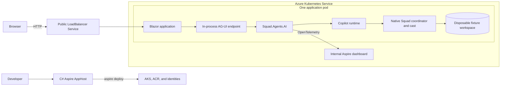
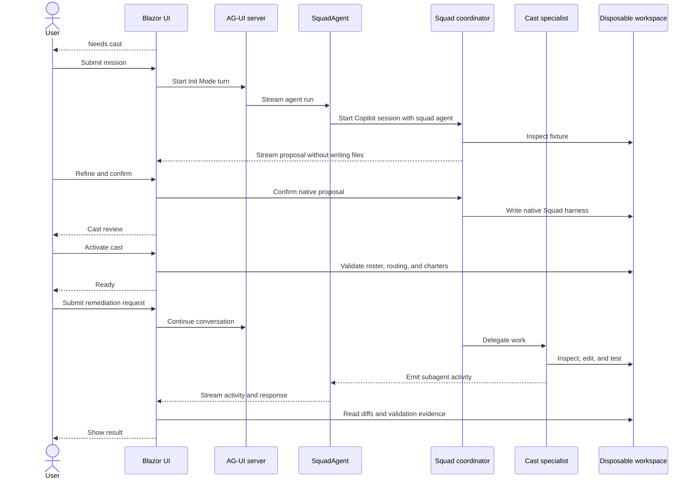

# Squad on AKS

**Cast a real [Squad](https://github.com/bradygaster/squad), talk to it through a Blazor application, and run the whole disposable experience in Azure Kubernetes Service.**

Squad on AKS is a focused Aspire reference sample. One C# AppHost owns local development, telemetry, Azure provisioning, deployment, and cleanup. One AKS application pod contains the Blazor UI, AG-UI endpoint, `Squad.Agents.AI`, Copilot runtime, native Squad coordinator, and a disposable fixture repository.

The workspace begins without a cast. The first conversation asks what the Squad should do, uses Squad's native Init Mode to propose a team, lets you refine and review the generated harness, and accepts work only after you activate the cast.

```text
┌─ Squad on AKS ─────────────────────────────────────────────────────────────┐
│ sample-api                                           AKS · Needs cast     │
│                                                                           │
│ There is no Squad yet. What should this team be responsible for?          │
│                                                                           │
│ You                                                                       │
│ Maintain this .NET API. Implement small features, test them, and review    │
│ changes before presenting the result.                                     │
│                                                                           │
│ Squad                                                      Casting...     │
│ Proposed cast                                                            │
│   FLIGHT · Lead       GNC · API specialist       TELMU · Tester           │
│   RETRO  · Reviewer   Scribe · Team memory                                │
│                                                                           │
│ [Ask for changes] [Review harness] [Accept cast and start Squad]           │
└───────────────────────────────────────────────────────────────────────────┘
```

> [!IMPORTANT]
> This is intentionally the smallest useful AKS sample. It does not provide durable state, multiple users, pull request automation, per-request Kubernetes Jobs, fleet management, TLS, or production identity. The exact contract is tracked in [Wave 1: Run an interactive Squad in AKS with Blazor](https://github.com/bradygaster/squad-on-aks/issues/3).

## What you will see

After deployment you can:

1. describe the mission for a new Squad;
2. watch native Init Mode propose a cast without writing team files;
3. refine the proposal conversationally;
4. review and edit only the generated roster, routing, and active charters;
5. activate the cast after local validation;
6. ask the API specialist to repair the included fixture and add a test;
7. observe real specialist and reviewer activity, file changes, and test output;
8. inspect correlated logs and `squad.subagent` traces;
9. replace the pod and prove that its cast, conversation, and work disappear.

The deployed topology stays deliberately small:



The Aspire dashboard is the only supporting workload. It remains internal, receives logs and traces, and has no authority over conversations or work. The application itself remains one Deployment with one replica.

## Three-step quickstart

### Prerequisites

Install:

- [.NET 10 SDK](https://dotnet.microsoft.com/download);
- [Aspire CLI](https://aspire.dev/get-started/install-cli/);
- [Azure CLI](https://learn.microsoft.com/cli/azure/install-azure-cli);
- an OCI container runtime supported by Aspire;
- [`kubectl`](https://kubernetes.io/docs/tasks/tools/);
- [Helm 4.2.0 or later](https://helm.sh/docs/intro/install/);
- Git.

You also need:

- an Azure subscription where you can create a resource group, AKS cluster, Azure Container Registry, managed identities, and role assignments;
- a [Copilot SDK-supported credential](https://github.com/github/copilot-sdk/blob/main/docs/auth/authenticate.md).

Wave 1 uses one server-side credential for one trusted sample user. A classic `ghp_` personal access token is not supported by the Copilot SDK. The credential is passed to Aspire as the secret parameter `copilot-github-token`, rendered into one Kubernetes Secret, and never sent to the browser.

### Timing

- **Human interaction:** no more than three manual steps and normally under five minutes.
- **New Azure environment:** AKS provisioning can take 20-40 minutes after submission.
- **Existing environment or redeployment:** usually 5-10 minutes when Azure capacity is available.

`aspire deploy` reports its pipeline stages while Azure works. The longer provisioning time does not require additional human interaction.

### 1. Clone

```bash
git clone https://github.com/bradygaster/squad-on-aks.git
cd squad-on-aks
```

### 2. Authenticate and provide the sample credential

```bash
az login
export Parameters__copilot_github_token="$COPILOT_GITHUB_TOKEN"
```

Expected:

```text
You have logged in. Now let us find all the subscriptions to which you have access...
```

`export` is silent. The environment variable uses underscores because Aspire parameter environment variables cannot contain dashes. Do not print, commit, or paste this value into an issue or test artifact.

### 3. Deploy

```bash
aspire deploy
```

On the first deployment, select the Azure subscription and location when Aspire prompts. Expected progress:

```text
Deploying AppHost: SquadOnAks.AppHost

  ✓ Resolve parameters
  ✓ Provision resource group
  ✓ Provision Azure Container Registry
  ✓ Provision Azure Kubernetes Service
  ✓ Configure managed identities and role assignments
  ✓ Build and push squad-on-aks image
  ✓ Generate and install Helm release
  ✓ Wait for squad-on-aks to become healthy

Deployment succeeded
Application: http://<public-address>/
Dashboard:   internal-only
```

The Azure model contains one Free-tier AKS control plane, one fixed one-node system pool, one ACR, and only the identities and role assignments required by the official Aspire AKS integration.

## Local development

Use the same AppHost locally:

```bash
export Parameters__copilot_github_token="$COPILOT_GITHUB_TOKEN"
aspire start --isolated
aspire wait squad-on-aks
```

Expected:

```text
Resource squad-on-aks is Running
Health: Healthy
Endpoints:
  http://localhost:<port>
```

The local Aspire dashboard opens with the AppHost. Local and deployed execution use the same application project, Squad registration, health checks, and OpenTelemetry instrumentation.

## Cast the Squad

Open the application URL. The page reaches **Needs cast** only after:

1. the disposable workspace is initialized;
2. the real `.github/agents/squad.agent.md` is present;
3. native Init Mode assets are discoverable;
4. `SquadAgent` resolves from dependency injection;
5. the Copilot runtime can start with the configured credential.

Readiness means casting can begin. It does not mean a team already exists, and it never calls a model merely to answer a health probe.

Use the included mission:

> Maintain this .NET API. Implement small features, test them, and review changes before presenting the result.

Squad's native Init Mode inspects the fixture and streams a proposed cast. The proposal phase writes nothing.

```text
Proposed cast

FLIGHT  Lead             Scope, decisions, and final response
GNC     API specialist   ASP.NET Core API implementation
TELMU   Tester           Integration tests and edge cases
RETRO   Reviewer         Correctness, accessibility, maintainability
Scribe  Team memory      Decisions and session history
```

Names can vary. Roles, responsibilities, and native file behavior are the acceptance boundary.

Refine the proposal in the same conversation:

```text
Make the tester focus on integration tests.
Add accessibility review to the reviewer's charter.
Remove any role that does not contribute to this API.
```

After confirmation, Squad writes its native harness. The **Review cast** panel exposes only:

- `.squad/team.md`;
- `.squad/routing.md`;
- `.squad/agents/*/charter.md` for active members.

The editor rejects traversal, symlink escape, and every other file. **Start taking requests** remains disabled until local validation proves that the roster has members, every referenced charter exists, and routing names only active members. Activation does not call a model.

## Complete the remediation flight

After activation, send:

> Ask the API specialist to inspect this repository, repair the known fixture defect with a test, and have the reviewer check the result.

The response streams through the real AG-UI HTTP boundary. The activity panel is driven by native subagent events and OpenTelemetry rather than assistant prose:

```text
00:00  FLIGHT  Planning the request
00:03  GNC     Specialist started
00:09  GNC     Inspecting the sample API
00:31  GNC     Implementation complete
00:33  TELMU   Running the focused test
00:45  RETRO   Review started
00:53  RETRO   Review complete
00:55  FLIGHT  Final response complete
```

The evidence panel separates generated harness files from application work:

```text
Generated harness
  A .squad/team.md
  A .squad/routing.md
  A .squad/agents/gnc/charter.md
  ...

Application changes
  M src/SampleApi/Program.cs
  A tests/SampleApi.Tests/KnownDefectTests.cs

Validation
  dotnet test
  Passed: 18  Failed: 0  Skipped: 0
  Exit code: 0
```

Send a follow-up:

> Explain the implementation and why the test proves the defect is repaired.

The active thread retains the preceding conversation and current workspace. Neither survives application pod replacement.

## Request lifecycle



### Truthful states

| State | Meaning |
|---|---|
| **Starting** | The process, workspace, agent, or Copilot runtime is initializing. |
| **Needs cast** | The application is healthy but the native roster is empty. |
| **Casting** | Init Mode is proposing or refining the team. |
| **Cast review** | Native files exist and can be reviewed through the allowlist. |
| **Ready** | The cast passed local validation and work can begin. |
| **Active** | One turn is streaming. |
| **Cancelling** | Cancellation was requested and the app is awaiting the observed result. |
| **Failed** | Startup or a turn failed; the visible category and evidence remain available. |
| **Replacing** | The browser lost the application pod and is waiting for a replacement. |

The pod accepts one active conversation and one active turn. A competing submission receives visible `409 Conflict` busy behavior; it is not silently queued.

Cancellation requests the underlying operation to stop and then reports what actually happened: cancelled, completed before cancellation, or failed. It does not claim that file changes were rolled back. A browser disconnect does not manufacture success or cancellation.

## Disposable by design

The image contains a read-only fixture seed and Squad bootstrap assets. An init container copies the fixture into an `emptyDir` mounted at `/workspace`.

```yaml
volumes:
  - name: workspace
    emptyDir:
      sizeLimit: 2Gi
```

The production container:

- runs non-root;
- has only the intended workspace path writable;
- drops unnecessary privileges;
- declares CPU, memory, and ephemeral-storage requests and limits;
- receives the Copilot credential only through a Kubernetes Secret;
- exposes liveness and readiness probes;
- handles `SIGTERM` with truthful active/cancelling/failed state.

Deleting the application pod deletes its cast, conversation, generated harness, and application changes. The replacement copies a pristine fixture and returns to **Needs cast**.

## What Aspire provisions

The C# AppHost is the deployment source of truth. `aspire publish` generates reviewable Bicep and Helm artifacts; `aspire deploy` applies the model directly and does not consume a previously published output directory.

| Resource | Purpose |
|---|---|
| Resource group | Contains all sample-owned Azure resources |
| Azure Kubernetes Service | Free-tier control plane and one fixed system-pool node |
| Azure Container Registry | Stores the pinned application image |
| Control-plane and kubelet managed identities | Operate AKS and pull the image |
| Application Deployment | Runs one replica of the Blazor/Squad application |
| Public `LoadBalancer` Service | Exposes only the application HTTP endpoint |
| Internal Aspire dashboard | Receives logs and OpenTelemetry traces |
| Kubernetes Secret | Supplies the sample Copilot credential |
| Init container and `emptyDir` | Create the disposable fixture workspace |

The baseline does **not** create AGC, Gateway API, cert-manager, ingress, Front Door, DNS, TLS, a VNet customization, Application Insights, Log Analytics, SQL, Service Bus, Blob Storage, Redis, KEDA, a PVC, or an additional node pool.

## Operations

### Inspect the deployment model

```bash
aspire publish --list-steps
aspire publish -o ./artifacts/aspire
```

Review the generated Bicep and Helm output before deployment. It must match the resource budget above.

### Show application status

```bash
aspire ps
kubectl get deployment,pod,service -n squad-on-aks
```

Expected:

```text
deployment.apps/squad-on-aks   1/1   1   1
pod/squad-on-aks-...           1/1   Running
service/squad-on-aks           LoadBalancer   <public-address>
```

### Read application logs

```bash
aspire logs squad-on-aks
```

Logs include startup, workspace initialization, casting and turn boundaries, native specialist activity, cancellation results, and validation summaries. Credential values and authorization headers are redacted.

### Inspect traces

For local development, open the dashboard URL printed by `aspire start`. For AKS, use the included operator command:

```bash
./eng/dashboard
```

This opens a temporary local port-forward to the internal dashboard Service. The dashboard is never assigned a public address. A successful acceptance run contains correlated `squad.subagent` activities for the specialist and reviewer; a convincing text response without those activities does not pass.

### Prove the workspace is disposable

```bash
kubectl exec deployment/squad-on-aks -n squad-on-aks -- \
  git -C /workspace status --short

kubectl delete pod -n squad-on-aks \
  -l app.kubernetes.io/name=squad-on-aks

kubectl rollout status deployment/squad-on-aks -n squad-on-aks

kubectl exec deployment/squad-on-aks -n squad-on-aks -- \
  git -C /workspace status --short
```

The first status shows the remediation changes. The final status is clean, and the replacement UI returns to **Needs cast**.

### Redeploy

```bash
aspire deploy
```

Redeployment reconciles the same one-node, one-replica topology without manual Azure, Helm, or `kubectl` mutation.

### Clean up

```bash
aspire destroy --yes
```

Expected:

```text
Destroying AppHost: SquadOnAks.AppHost
  ✓ Remove Helm release
  ✓ Remove Aspire-owned Azure resource group
Destroy completed
```

Review the selected subscription and resource group before confirming destructive commands.

## Troubleshooting

| Symptom | Check | Resolution |
|---|---|---|
| Aspire cannot find the AppHost | `aspire ls` | Run commands from the repository root and verify the pinned Aspire CLI version. |
| Deployment stops during preflight | `az account show`, `kubectl version --client`, `helm version` | Authenticate to the intended subscription and install the pinned prerequisite versions. |
| Secret parameter is missing | Confirm `Parameters__copilot_github_token` exists without printing it | Export a Copilot SDK-supported credential and rerun `aspire deploy`. |
| Readiness remains false | `aspire logs squad-on-aks` | Resolve the reported workspace, native Squad asset, DI, or Copilot startup failure. |
| Casting writes files before confirmation | Run the casting contract test | Treat it as a blocker; native proposal mode must write nothing. Do not add another casting engine. |
| Activation remains disabled | Open cast validation details | Correct the missing charter, unknown routing member, empty roster, or invalid allow-listed file. |
| Another request gets `409 Conflict` | Inspect the lifecycle indicator | Wait for or cancel the one active turn; Wave 1 has no queue. |
| No specialist activity appears | Inspect `squad.subagent` traces | Verify the real Squad definition and known delegated acceptance prompt were used. |
| Pod is `Pending` | `kubectl describe pod -n squad-on-aks -l app.kubernetes.io/name=squad-on-aks` | Check regional quota and capacity for the pinned one-node VM size. |
| Public address remains pending | `kubectl describe service squad-on-aks -n squad-on-aks` | Inspect Azure Load Balancer events; do not add ingress or Front Door as a workaround. |
| Conversation or changes disappeared | Check pod UID and age | Expected after replacement; Wave 1 intentionally has no persistence. |
| Destroy is incomplete | `aspire destroy`, then inspect the selected resource group | Record the exact Aspire-owned leftover and fix teardown ownership rather than deleting unrelated resources. |

## Repository layout

```text
.
├── README.md
├── global.json
├── Directory.Packages.props
├── SquadOnAks.sln
├── src/
│   ├── SquadOnAks.AppHost/
│   │   ├── AppHost.cs                 # Local and AKS resource model
│   │   └── SquadOnAks.AppHost.csproj
│   ├── SquadOnAks.ServiceDefaults/    # Health and OpenTelemetry defaults
│   └── SquadOnAks.Web/
│       ├── Components/                # Casting, chat, activity, evidence
│       ├── Agents/                    # AG-UI and SquadAgent registration
│       ├── Lifecycle/                 # Truthful state and cancellation
│       ├── Workspace/                 # Fixture, allowlist, diffs, validation
│       ├── Program.cs
│       └── Dockerfile
├── sample/
│   ├── repository/                    # Deterministic API fixture
│   └── squad/
│       ├── .github/agents/squad.agent.md
│       └── .squad/                    # Init Mode assets and empty roster
├── tests/
│   ├── SquadOnAks.Tests/
│   ├── SquadOnAks.Playwright/         # Deterministic browser suite
│   └── SquadOnAks.LiveTests/          # Opt-in local and AKS suites
└── eng/
    ├── preflight
    ├── dashboard
    └── smoke
```

## Validation strategy

The sample has three explicit test layers:

1. **Deterministic Playwright for .NET:** drives the real Blazor UI and AG-UI HTTP endpoint with scripted agent, event, and workspace adapters. It covers casting gates, allowlist enforcement, activation failures, streaming, follow-up, delegation evidence, busy behavior, cancellation, failures, and replacement UI without model credits.
2. **Opt-in live local:** runs against `aspire start --isolated` with the real Copilot and Squad runtime.
3. **Opt-in live AKS:** runs against the public Service and coordinates with `kubectl` to prove pod replacement and internal-only dashboard exposure.

Tests use isolated browser contexts and accessible role/name selectors. Failures capture Playwright trace ZIPs, screenshots, browser console messages, and network diagnostics. Normal CI never calls a model or creates Azure resources.

## Architecture decisions

### Why Aspire

Aspire makes the AppHost the executable model for local orchestration, parameters, health, telemetry, generated Bicep/Helm, AKS provisioning, deployment, and cleanup. This removes the drift that would come from maintaining separate local scripts, Bicep, Kubernetes manifests, and an `azd` path.

This repository does not invent an Aspire hosting integration for Squad. `Squad.Agents.AI` is registered directly in the web application because upstream currently does not ship an `AddSquad` AppHost resource.

### Why AKS

The sample exists to demonstrate Squad as an observable Kubernetes workload. AKS provides the pod lifecycle, disposable volume, resource boundary, health probes, rollout behavior, public Service, and replacement semantics the sample teaches.

### Why `Squad.Agents.AI`

`Squad.Agents.AI` exposes the existing Squad coordinator as a Microsoft Agent Framework `AIAgent` with streaming and native subagent telemetry. Squad remains unchanged; there is no custom agent protocol or .NET rewrite.

### Why native casting

Casting is Squad's real first-run experience. Starting with a prebuilt team would prove only that an agent can run. Native Init Mode proves that a user can describe a mission, refine the resulting team, review its standard harness, and explicitly activate it.

The application supplies presentation, an allow-listed Markdown editor, local validation, and an activation gate. Squad remains responsible for proposing and creating the cast.

### Why one application pod

One pod keeps the vertical slice understandable. UI, agent host, Copilot runtime, Squad, conversation, and workspace share one lifecycle. It is intentionally not highly available. Replacement is a reset, not a recovery event.

### Why a plain LoadBalancer

The temporary trusted-user demo uses one public HTTP `LoadBalancer` Service. Adding AGC, ingress, Front Door, DNS, TLS, or user authentication would turn the sample into a networking and identity project before it proves the Squad experience.

### Why the dashboard stays internal

The official Aspire AKS integration includes an Aspire dashboard for logs and traces. Retaining it provides useful observability without adding Application Insights or a custom dashboard. Keeping it internal prevents a support surface from becoming a public or authoritative control plane.

## Security model and non-goals

Wave 1 bounds permissive agent execution with:

- one trusted user;
- one bundled deterministic fixture;
- one non-root application container;
- one pod-local `emptyDir`;
- no host mount or persistent volume;
- no production repository credential;
- one server-side Copilot credential;
- one application replica and one active turn;
- fixed resource requests and limits;
- secret redaction in logs, traces, UI, and test artifacts.

Do not point this sample at untrusted repositories or expose it as a multi-user service.

Wave 1 does not include:

- end-user login, GitHub App identity, per-user credentials, Key Vault, or secret rotation;
- HTTPS, DNS, ingress, Front Door, private networking, network policy, or service mesh;
- arbitrary repositories, commits, branches, pull requests, or remote GitHub writes;
- durable casts, conversations, workspaces, or evidence;
- databases, queues, KEDA, per-request Jobs, schedulers, or a durable control plane;
- multiple Squads, replicas, users, clusters, clouds, or deployment targets;
- autoscaling, multiple node pools, production alerting, cost accounting, or SLA claims.

## Delivery map

Implementation is intentionally gated:

| Milestone | Goal | Issues |
|---|---|---|
| Wave 1.0 | Retire package, casting, Aspire deployment, and test-harness risk | [#4](https://github.com/bradygaster/squad-on-aks/issues/4)-[#7](https://github.com/bradygaster/squad-on-aks/issues/7) |
| Wave 1.1 | Complete the local cast-to-remediation journey | [#8](https://github.com/bradygaster/squad-on-aks/issues/8)-[#12](https://github.com/bradygaster/squad-on-aks/issues/12) |
| Wave 1.2 | Prove the disposable production container | [#13](https://github.com/bradygaster/squad-on-aks/issues/13)-[#14](https://github.com/bradygaster/squad-on-aks/issues/14) |
| Wave 1.3 | Deploy and operate the bounded Aspire topology on AKS | [#15](https://github.com/bradygaster/squad-on-aks/issues/15)-[#16](https://github.com/bradygaster/squad-on-aks/issues/16) |
| Wave 1.4 | Run live Playwright and first-user acceptance | [#17](https://github.com/bradygaster/squad-on-aks/issues/17) |

Later milestones do not begin until the previous gate passes. A failed upstream assumption is a stop condition, not permission to add another protocol, casting engine, deployment tool, control plane, or infrastructure family.

## Done means this works end to end

Wave 1 is complete when a first-time user can:

- clone, authenticate/configure, and submit deployment in three manual steps and under five minutes of human interaction;
- observe longer Azure provisioning without further manual work;
- open one public HTTP application URL;
- start in **Needs cast** with a healthy but empty native roster;
- receive a native proposal before any team files are written;
- refine, confirm, review, and activate the cast;
- stream a real work conversation through `Squad.Agents.AI` and AG-UI;
- observe named specialist and reviewer activity backed by `squad.subagent` telemetry;
- inspect separated harness/application changes and passing test evidence;
- receive visible busy, cancellation, failure, and replacement states;
- replace the pod and prove the cast, conversation, and work are gone;
- redeploy idempotently;
- inspect internal Aspire telemetry;
- remove the Aspire-owned environment with `aspire destroy`.

> **One Aspire AppHost, one AKS application pod, one user-cast Squad, one real web conversation, observable and disposable end to end.**

## References

Aspire behavior in this repository is based only on:

- [Aspire AppHost](https://aspire.dev/get-started/app-host/)
- [Deploy Aspire apps to AKS](https://aspire.dev/deployment/kubernetes/aks/)
- [Aspire Kubernetes integration](https://aspire.dev/integrations/compute/kubernetes/)
- [`aspire deploy`](https://aspire.dev/reference/cli/commands/aspire-deploy/)
- [Official `microsoft/aspire` repository](https://github.com/microsoft/aspire)

Other authoritative project references:

- [Wave 1 requirements and execution plan](https://github.com/bradygaster/squad-on-aks/issues/3)
- [Squad](https://github.com/bradygaster/squad)
- [Squad team setup and Init Mode](https://github.com/bradygaster/squad/blob/dev/docs/src/content/docs/features/team-setup.md)
- [`Squad.Agents.AI`](https://github.com/bradygaster/squad/tree/dev/src/Squad.Agents.AI)
- [Microsoft Agent Framework AG-UI sample](https://github.com/microsoft/agent-framework/tree/main/dotnet/samples/05-end-to-end/AGUIWebChat)
- [Playwright for .NET](https://playwright.dev/dotnet/)
