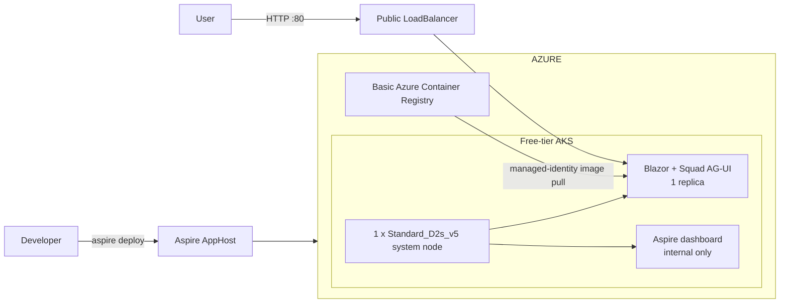

# Squad on AKS

**An Aspire-owned Blazor application with an in-process Squad AG-UI boundary,
health and OpenTelemetry defaults, and a proven AKS deployment topology.**

The current Wave 1 application is intentionally narrow: it provides the real
Blazor host, direct `Squad.Agents.AI` registration, and `/ag-ui` streaming
boundary while preserving the one-node AKS deployment proof. Casting UX,
fixture mutation, production hardening, per-request Kubernetes Jobs, and the
pull-request workflow remain later Wave 1 work.

The current implementation proves the deployment foundation for
[Wave 1](https://github.com/bradygaster/squad-on-aks/issues/3):

- a C# Aspire AppHost is the local and deployment source of truth;
- the Aspire `app` resource runs the ASP.NET Core Blazor Web App;
- the same process hosts the `Squad.Agents.AI` agent and `/ag-ui` endpoint;
- Aspire ServiceDefaults provides health and OpenTelemetry wiring;
- Aspire provisions AKS and Azure Container Registry;
- AKS has exactly one fixed, non-autoscaling system node;
- the application runs as one replica on that system node;
- the application is exposed through a public `LoadBalancer` Service;
- the Aspire dashboard remains an internal `ClusterIP` Service;
- a Kubernetes Secret carries the modeled Copilot parameter;
- an init container seeds a disposable `emptyDir` workspace;
- health probes and explicit resource budgets are applied; and
- `aspire destroy` removes both the Helm release and Azure resource group.

## Current architecture



The application exposes:

| Endpoint | Expected response |
|---|---|
| `GET /` | Blazor product scaffold headed `Squad on AKS` |
| `POST /ag-ui` | Streaming AG-UI server backed by `Squad.Agents.AI` |
| `GET /health/live` | HTTP 200 |
| `GET /health/ready` | HTTP 200 |

## Run locally

Set the required Aspire parameters, start the isolated AppHost, and wait for
the single web resource:

```bash
export Parameters__copilot_token="<copilot-supported-token>"
export Parameters__workspace_path="$PWD"

aspire start --isolated --non-interactive
aspire wait app --non-interactive
aspire describe --format Json --non-interactive
```

Open the `app` URL from `aspire describe`. Stop the isolated AppHost when done:

```bash
aspire stop --non-interactive
```

Both parameters are required. The web process fails at startup with an explicit
configuration error when the token is empty or the workspace path is missing
or does not name an existing directory.

## Deploy from a fresh clone

The commands below match the deployment path validated from this repository.
The first deployment creates billable Azure resources.

### Prerequisites

Install and configure:

- [Git](https://git-scm.com/);
- access to this private GitHub repository and Git credentials that can clone
  it;
- [.NET SDK 10.0.301](https://dotnet.microsoft.com/download), pinned by
  [`global.json`](global.json);
- [Azure CLI](https://learn.microsoft.com/cli/azure/install-azure-cli);
- Docker Desktop or another Docker-compatible container runtime;
- [`kubectl`](https://kubernetes.io/docs/tasks/tools/);
- [Helm](https://helm.sh/docs/intro/install/) (validated with Helm 4.3.1); and
- an Azure subscription where you can create a resource group, AKS cluster,
  ACR, managed identities, and role assignments.

The repository pins Aspire CLI 13.4.3 as a local .NET tool. You do not need a
separate global Aspire installation.

Before deploying, confirm that the target region has quota for one
`Standard_D2s_v5` VM and supports AKS.

### 1. Clone and restore the pinned tools

```bash
git clone https://github.com/bradygaster/squad-on-aks.git
cd squad-on-aks

dotnet --version
dotnet tool restore
aspire ls
```

Expected:

```text
10.0.301
1 AppHost found
src/SquadOnAks.AppHost/SquadOnAks.AppHost.csproj
```

If `dotnet --version` fails because 10.0.301 is unavailable, install that SDK;
the repository disables SDK roll-forward intentionally.

### 2. Authenticate and set the deployment inputs

Choose the Azure subscription, region, and resource-group name before running
the deployment:

```bash
az login
az account set --subscription "<subscription-name-or-id>"

export Azure__SubscriptionId="$(az account show --query id -o tsv)"
export Azure__Location="westus2"
export Azure__ResourceGroup="rg-squad-on-aks"

# Supply a Copilot-supported token to the deployed Squad host.
export Parameters__copilot_token="<copilot-supported-token>"
export Parameters__workspace_path="/workspace"
```

The AppHost parameter is named `copilot-token`. Aspire maps the dash to an
underscore in the environment variable, so the correct variable is
`Parameters__copilot_token`.

On macOS, Docker Desktop commonly configures a desktop credential store. The
validated Aspire deployment used an isolated Docker configuration so registry
login could complete without waiting on that credential helper:

```bash
export DOCKER_CONFIG="${TMPDIR:-/tmp}/squad-on-aks-docker"
mkdir -p "$DOCKER_CONFIG"
printf '{"auths":{}}\n' > "$DOCKER_CONFIG/config.json"
```

This file is temporary and outside the repository. Aspire logs in to the ACR
it provisions and writes only that temporary Docker configuration.

Verify the non-secret Azure context:

```bash
az account show \
  --query "{subscription:name, id:id, tenant:tenantId}" \
  --output table

printf 'region=%s\nresource-group=%s\n' \
  "$Azure__Location" \
  "$Azure__ResourceGroup"
```

Do not print a real Copilot credential if you replace the placeholder in a
future application version.

### 3. Deploy

```bash
aspire deploy --non-interactive
```

Aspire performs the complete deployment:

1. validates Azure, Helm, Docker, and Kubernetes prerequisites;
2. creates or reuses the resource group;
3. provisions Basic ACR;
4. provisions Free-tier AKS with one fixed `Standard_D2s_v5` system node;
5. configures managed identity and ACR pull access;
6. builds the application image;
7. logs in to ACR and pushes the image;
8. obtains temporary AKS credentials;
9. generates the Helm chart;
10. installs the `production` release into the `default` namespace; and
11. prints the public application URL.

A successful run ends with:

```text
✓ 34/34 steps succeeded

☁️ Target: Azure
📦 Resource Group: <your-resource-group>
☸ AKS Cluster: <generated-cluster-name>
📊 Dashboard: kubectl port-forward ...
📋 Release status: helm status production -n default
app: http://<public-ip>
```

The validated first deployment required several minutes of unattended Azure
provisioning. Regional capacity and subscription policy can make AKS
provisioning take longer. Aspire continuously prints the active pipeline
steps; no separate Bicep, Helm, or `az deployment` command is required.

## Connect to the deployed cluster

Aspire uses a temporary kubeconfig while deploying. Create a kubeconfig you
can reuse for inspection and, importantly, for `aspire destroy`:

```bash
export AKS_NAME="$(
  az aks list \
    --resource-group "$Azure__ResourceGroup" \
    --query '[0].name' \
    --output tsv
)"

export KUBECONFIG="${TMPDIR:-/tmp}/squad-on-aks-kubeconfig"

az aks get-credentials \
  --resource-group "$Azure__ResourceGroup" \
  --name "$AKS_NAME" \
  --file "$KUBECONFIG" \
  --overwrite-existing
```

Confirm the topology:

```bash
kubectl get nodes \
  -o custom-columns='NAME:.metadata.name,POOL:.metadata.labels.agentpool,CPU:.status.capacity.cpu'

kubectl get deployments,pods,services --namespace default

helm status production --namespace default
```

Expected characteristics:

```text
POOL
system

app-deployment             1/1
aks-dashboard-deployment   1/1
app-service                LoadBalancer
aks-dashboard-service      ClusterIP
```

## Open and verify the application

Get the public IP:

```bash
kubectl get service app-service --namespace default --watch
```

Wait until `EXTERNAL-IP` is populated, stop the watch with `Ctrl+C`, then:

```bash
export APP_IP="$(
  kubectl get service app-service \
    --namespace default \
    --output jsonpath='{.status.loadBalancer.ingress[0].ip}'
)"

curl --fail "http://${APP_IP}/"
curl --fail "http://${APP_IP}/health/live"
curl --fail "http://${APP_IP}/health/ready"
```

The root response contains `Squad on AKS`; both health requests return HTTP
200. The AG-UI endpoint is a streaming `POST` API and is validated by the
scripted client described below.

If the public IP times out while Kubernetes reports a ready endpoint, verify
the application through a port-forward:

```bash
kubectl port-forward service/app-service 18080:8080
```

In another terminal using the same repository and environment:

```bash
curl --fail http://127.0.0.1:18080/
curl --fail http://127.0.0.1:18080/health/live
curl --fail http://127.0.0.1:18080/health/ready
```

The public Service is plain HTTP with no authentication or TLS. It is a
deployment proof, not a production ingress design.

## Open the internal Aspire dashboard

The dashboard intentionally has no public IP:

```bash
kubectl port-forward \
  --namespace default \
  service/aks-dashboard-service \
  18888:18888
```

Open <http://127.0.0.1:18888>. If the dashboard asks for a token, retrieve the
startup output:

```bash
kubectl logs \
  --namespace default \
  --selector app.kubernetes.io/component=aks-dashboard \
  --tail 50
```

Do not publish the dashboard Service or its login token.

## What the AppHost provisions

| Resource | Current configuration |
|---|---|
| Resource group | Name supplied through `Azure__ResourceGroup` |
| AKS control plane | Free tier |
| AKS node pool | One `Standard_D2s_v5` system node, fixed count 1, autoscaling disabled |
| ACR | Basic SKU |
| Application | One replica scheduled to `agentpool: system` |
| Application Service | Public `LoadBalancer`, TCP 80 mapped to container port 8080 |
| Dashboard Service | Internal `ClusterIP` |
| Workspace | `emptyDir`, size limit `2Gi` |
| Init container | `mcr.microsoft.com/azurelinux/base/core:3.0` |
| Application requests | `50m` CPU, `512Mi` memory, `1Gi` ephemeral storage |
| Application limits | `500m` CPU, `1Gi` memory, `2Gi` ephemeral storage |
| Secret | Opaque Kubernetes Secret containing `copilot-token` |

The deployment does **not** create ingress, TLS, DNS, Application Gateway for
Containers, a VNet customization, SQL, Service Bus, persistent volumes, KEDA,
Application Insights, or an additional node pool.

## Preview the generated deployment

Generate the Aspire-owned Bicep and Helm artifacts without creating Azure
resources:

```bash
export Parameters__copilot_token="<copilot-supported-token>"
export Parameters__workspace_path="/workspace"
aspire publish --output-path ./artifacts/aspire --non-interactive
```

The output includes:

```text
artifacts/aspire/
├── main.bicep
├── aks/
│   └── aks.bicep
├── aks-acr/
│   └── aks-acr.bicep
├── Chart.yaml
├── values.yaml
└── templates/
```

Published artifacts are for review or handoff. `aspire deploy` resolves and
applies the AppHost model directly; it does not deploy from that output
directory.

## Redeploy

Keep the Azure variables and isolated `DOCKER_CONFIG` set, then run:

```bash
aspire deploy --non-interactive
```

The validated success-to-success redeployment reused the Azure resources,
pushed a new image tag, upgraded the Helm release, and completed all 34 steps
in about 19 seconds.

## Clean up

Make sure `KUBECONFIG` still points to credentials for the Aspire-owned AKS
cluster:

```bash
kubectl cluster-info
helm status production --namespace default
```

Then run the Aspire destroy pipeline:

```bash
aspire destroy --non-interactive --yes
```

Expected:

```text
✓ Helm release production uninstalled
✓ Resource group deletion in progress
✓ Deployment state cleared
✓ 11/11 steps succeeded
```

Azure resource-group deletion continues asynchronously. Wait for completion:

```bash
az group wait \
  --name "$Azure__ResourceGroup" \
  --deleted \
  --interval 15 \
  --timeout 1200

az group exists --name "$Azure__ResourceGroup"
```

The final command should print `false`.

> [!CAUTION]
> `aspire destroy --yes` deletes the configured Aspire-owned resource group.
> Confirm `Azure__SubscriptionId`, `Azure__ResourceGroup`, and your active Azure
> account before running it.

## Troubleshooting

| Symptom | Cause or next check |
|---|---|
| `aspire ls` finds no AppHost | Run the command from the repository root and run `dotnet tool restore`. |
| SDK resolution fails | Install exactly .NET SDK 10.0.301; `global.json` disables roll-forward. |
| AKS provisioning fails | Check regional VM-family quota, total regional vCPU quota, subscription policy, and `Standard_D2s_v5` availability. |
| ACR login hangs on macOS | Use the isolated `DOCKER_CONFIG` shown above instead of the Docker Desktop credential store. |
| ACR hostname briefly returns `NXDOMAIN` after recreation | Wait for DNS propagation and retry `aspire deploy`; a local negative DNS cache may also need to expire. |
| The application pod is `Pending` | Run `kubectl describe pod`; the one-node design has limited allocatable CPU after AKS system pods and the dashboard. |
| The public IP times out | Confirm the pod, EndpointSlice, Service, Azure load-balancer rule, and NSG rule; use port-forward to separate application health from local outbound filtering. |
| `aspire destroy` cannot uninstall Helm | Refresh AKS credentials, export the resulting `KUBECONFIG`, confirm `helm status production -n default`, and rerun the destroy command. |
| A resource group was deleted outside Aspire and deploy reuses stale outputs | Prefer `aspire destroy`. Out-of-band deletion can leave local state under `~/.aspire/deployments`; inspect the Aspire log before removing the state file for this AppHost/environment. |

## Validate the repository

Restore, build, and format-check:

```bash
dotnet restore SquadOnAks.slnx --locked-mode --nologo
dotnet build SquadOnAks.slnx \
  --configuration Release \
  --no-restore \
  --nologo
dotnet format SquadOnAks.slnx --verify-no-changes --no-restore
```

Run the native Squad/AG-UI casting boundary probe:

```bash
./scripts/run-native-casting-probe.sh
```

Run the deterministic production-host AG-UI boundary smoke:

```bash
./scripts/run-agui-smoke.sh
```

The smoke starts the same Blazor/AG-UI composition with a scripted
`IChatClient`, sends a turn through an external `AGUIChatClient`, and requires
the streamed response to cross `/ag-ui`.

Run the deterministic browser acceptance layer:

```bash
dotnet run \
  --project test/SquadOnAks.AcceptanceTests \
  --configuration Release \
  --no-build \
  -- \
  --layer deterministic
```

The acceptance host is test-only. It proves the planned browser and AG-UI
contract with scripted seams; it is not the deployed application.

## Repository layout

```text
.
├── .config/
│   └── dotnet-tools.json              # Aspire CLI 13.4.3
├── docs/
│   ├── evidence/w03/                  # Reproducible AKS/Bicep/Helm evidence
│   ├── native-casting-probe.md
│   └── stack-compatibility.md
├── scripts/
│   ├── run-agui-smoke.sh
│   └── run-native-casting-probe.sh
├── src/
│   ├── SquadOnAks.AppHost/            # Aspire AKS deployment model
│   ├── SquadOnAks.DeploymentProbe/    # Preserved W03 deployment proof
│   ├── SquadOnAks.ServiceDefaults/    # Health, discovery, resilience, OTel
│   └── SquadOnAks.Web/                # Product Blazor + in-process AG-UI host
├── test/
│   ├── SquadOnAks.AguiSmoke/          # Scripted AGUIChatClient evidence
│   ├── SquadOnAks.AcceptanceHost/     # Test-only Blazor/AG-UI host
│   ├── SquadOnAks.AcceptanceTests/    # Deterministic and gated live layers
│   └── SquadOnAks.StackProbe/         # Native Squad casting probe
├── aspire.config.json
├── Directory.Packages.props
├── global.json
└── SquadOnAks.slnx
```

## What remains

The repository has retired the initial stack, native-casting, browser-test,
minimal AKS deployment, and production-host scaffolding risks. It still needs
the later Wave 1 behavior:

- cast review and activation UX;
- the bundled remediation fixture and real work journey;
- hardened non-root production packaging;
- operational helpers and live-AKS browser acceptance.

Track that work in the
[Wave 1 parent issue](https://github.com/bradygaster/squad-on-aks/issues/3)
and its child issues. Until those issues land, treat this repository as a
validated deployment foundation rather than a completed Squad product sample.

## References

Aspire behavior in this repository is based on:

- [Aspire AppHost](https://aspire.dev/get-started/app-host/)
- [Deploy Aspire apps to AKS](https://aspire.dev/deployment/kubernetes/aks/)
- [Aspire Kubernetes integration](https://aspire.dev/integrations/compute/kubernetes/)
- [`aspire deploy`](https://aspire.dev/reference/cli/commands/aspire-deploy/)
- [Official `microsoft/aspire` repository](https://github.com/microsoft/aspire)

Project evidence:

- [Pinned stack compatibility](docs/stack-compatibility.md)
- [Native casting probe](docs/native-casting-probe.md)
- [Aspire-to-AKS deployment evidence](docs/evidence/w03/README.md)
- [Deterministic Playwright layers](test/SquadOnAks.AcceptanceTests/README.md)
