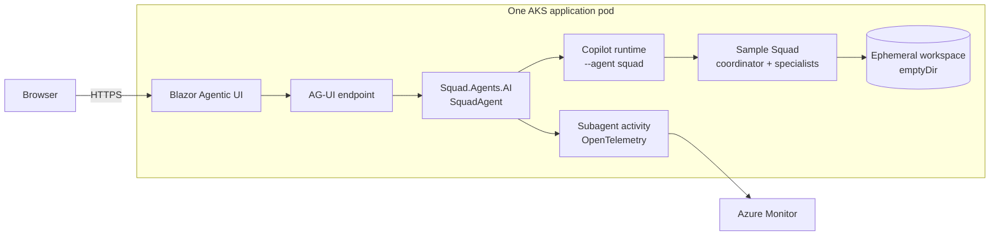
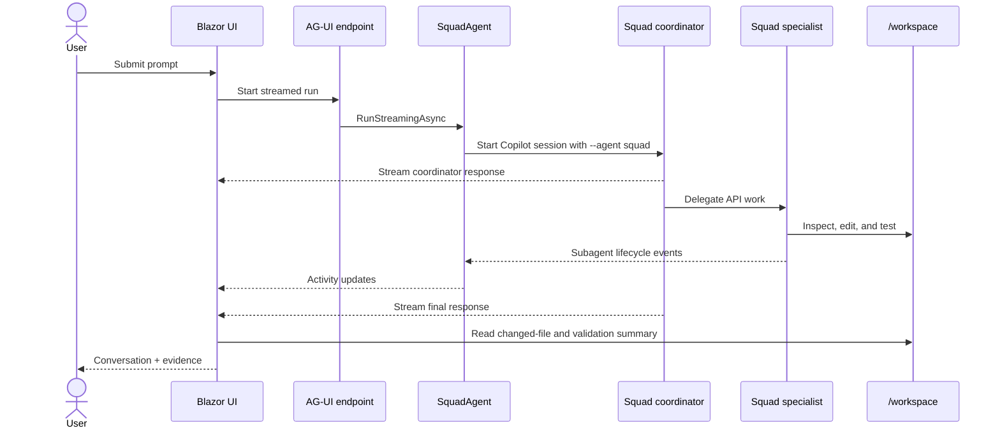

# Squad on AKS

**Run a real [Squad](https://github.com/bradygaster/squad) inside Azure Kubernetes Service and talk to it from a Blazor web application.**

Squad on AKS is a focused reference sample: one ASP.NET Core application, one configured Squad, one AKS application pod, and one disposable repository workspace. The browser streams a real Squad conversation, shows specialist activity as the coordinator delegates work, and reports the files and validation results produced inside the pod.

The sample uses [`Squad.Agents.AI`](https://github.com/bradygaster/squad/tree/dev/src/Squad.Agents.AI) directly. Squad remains unchanged; this repository hosts it as a Microsoft Agent Framework `AIAgent` and presents it through the Blazor Agentic UI components.

```text
┌─ Squad on AKS ──────────────────────────────────────────────────────────────┐
│ Connected to sample-api                                    AKS · Ready     │
│                                                                            │
│ You                                                                        │
│ Ask the API specialist to add a /health endpoint with a test, then have    │
│ the reviewer check the result.                                             │
│                                                                            │
│ Squad                                                       Working...     │
│ I will inspect the service and delegate implementation and review.         │
│                                                                            │
│ Activity                                                                   │
│ ● coordinator   Planning the work                                          │
│ ✓ api           Added /health and tests                                    │
│ ● reviewer      Reviewing the implementation                               │
│                                                                            │
│ Workspace                                                                  │
│ M src/Api/Program.cs        A tests/Api.Tests/HealthEndpointTests.cs        │
│ ✓ 18 tests passed                                                          │
└────────────────────────────────────────────────────────────────────────────┘
```

> [!IMPORTANT]
> Wave 1 intentionally demonstrates the smallest useful experience. It does not provide durable conversations, pull request automation, multiple concurrent users, per-session Kubernetes Jobs, fleet management, or a production identity system. The complete requirements and acceptance criteria are tracked in [Wave 1: Run an interactive Squad in AKS with Blazor](https://github.com/bradygaster/squad-on-aks/issues/3).

## What you will build

The finished sample deploys:

- an **ASP.NET Core Blazor Web App** with the chat and activity experience;
- an in-process **AG-UI endpoint** backed by `Squad.Agents.AI`;
- the existing **Squad and Copilot runtime**, unchanged;
- a small sample Squad with coordinator, API specialist, and reviewer roles;
- an **ephemeral workspace** populated with a deterministic sample repository;
- health endpoints, structured logs, and OpenTelemetry traces;
- one container image in Azure Container Registry;
- one AKS application deployment with one replica;
- an Azure Front Door HTTPS endpoint and Azure Monitor-backed observability.

The result is a vertical slice, not a platform:



All application components run together in the same pod. There is no separate scheduler, queue, workflow database, worker service, or custom Squad protocol.

## Quickstart

### Prerequisites

Install:

- [Git](https://git-scm.com/downloads)
- [Azure CLI](https://learn.microsoft.com/cli/azure/install-azure-cli)
- [Azure Developer CLI](https://learn.microsoft.com/azure/developer/azure-developer-cli/install-azd)
- access to an Azure subscription where you can create a resource group, AKS cluster, container registry, and role assignments
- a Copilot-supported GitHub credential exported as `COPILOT_GITHUB_TOKEN`

The [Copilot SDK authentication documentation](https://github.com/github/copilot-sdk/blob/main/docs/auth/authenticate.md) lists supported credentials. For Wave 1, the credential is a sample deployment secret used by the single application instance. Do not use a classic `ghp_` personal access token; the Copilot SDK does not support it.

You do not need to install .NET, Node.js, `kubectl`, Helm, Squad, or the Copilot CLI for the standard deployment path. The build and container image carry the required runtime, and deployment hooks apply the Kubernetes resources through Azure CLI. Install `kubectl` only if you want to run the optional operations commands later in this guide.

### Timing

- **Human interaction:** three steps and normally under five minutes.
- **New Azure environment:** AKS and supporting resources can take 20-40 minutes to provision.
- **Existing environment:** an application-only redeployment normally completes in 5-10 minutes.

`azd up` streams progress. After Azure accepts the deployment, you can leave it running unattended and return to `azd show`.

### 1. Clone

```bash
git clone https://github.com/bradygaster/squad-on-aks.git
cd squad-on-aks
```

### 2. Authenticate and configure the sample credential

```bash
azd auth login
azd env set COPILOT_GITHUB_TOKEN "$COPILOT_GITHUB_TOKEN"
```

Expected:

```text
Logged in to Azure.
Environment value COPILOT_GITHUB_TOKEN set.
```

`azd` stores the local environment under `.azure/`, which is ignored by Git but still contains sensitive local configuration and must not be shared. The deployment writes the credential to the cluster as a Kubernetes Secret and exposes it only to the application container. Wave 1 does not implement user sign-in or per-user credentials.

### 3. Deploy

```bash
azd up
```

Select a subscription and location when prompted.

Expected:

```text
Provisioning Azure resources
  ✓ Resource group
  ✓ Azure Container Registry
  ✓ Azure Kubernetes Service
  ✓ Azure Front Door endpoint
  ✓ Log Analytics and Application Insights

Building and publishing squad-on-aks
  ✓ Container image pushed
  ✓ Kubernetes Secret applied
  ✓ Deployment available: 1/1
  ✓ Readiness probe passed

SUCCESS: Squad on AKS is ready
Web:    https://squad-on-aks.<generated-hostname>/
Health: https://squad-on-aks.<generated-hostname>/health/ready
```

The exact hostname depends on the selected Azure environment. `azd show` prints it again later.

## First conversation

Open the URL printed by `azd up`. The page reports **Ready** only after:

1. the pod-local workspace has been initialized;
2. `.github/agents/squad.agent.md` is present;
3. `SquadAgent` resolves successfully from dependency injection;
4. the Copilot runtime can start with the configured credential.

Use the included acceptance prompt:

> Ask the API specialist to inspect this repository, add a `/health` endpoint with a test, and have the reviewer check the result.

The chat response streams as it is produced. The activity panel separately reports coordinator and specialist events:

```text
00:00  coordinator  Planning the request
00:03  api          Specialist started
00:11  api          Inspecting the sample API
00:37  api          Implementation complete
00:39  reviewer     Specialist started
00:54  reviewer     Review complete
00:55  coordinator  Final response complete
```

The workspace panel then shows concrete evidence:

```text
Changed files
  M src/Api/Program.cs
  A tests/Api.Tests/HealthEndpointTests.cs

Validation
  dotnet test
  Passed: 18 · Failed: 0 · Skipped: 0
```

Send a follow-up in the same browser session:

> Explain the implementation and why the test proves the endpoint is healthy.

The response uses the preceding conversation and current workspace. Conversation state is scoped to the running application instance and is not durable across pod replacement.

## How the application works

The application registers the Squad package as the agent implementation:

```csharp
builder.Services.AddSquadAgent(options =>
{
    options.SquadFolderPath = "/workspace";
    options.OnSubagentTrace = activityFeed.Record;
});
```

The Microsoft Agent Framework/AG-UI hosting integration exposes that agent to the Blazor application. The UI uses `AGUIChatClient` and the Blazor AI components to render streaming messages and typed interaction state.



### Sample Squad

The image contains a real Squad definition:

```text
/workspace/.github/agents/squad.agent.md
/workspace/.squad/team.md
/workspace/.squad/agents/api/charter.md
/workspace/.squad/agents/reviewer/charter.md
```

The coordinator delegates implementation to the API specialist and validation to the reviewer. The application does not simulate these events: the activity panel consumes `Squad.Agents.AI` subagent trace callbacks, and the same dispatches appear as `squad.subagent` OpenTelemetry spans.

### Ephemeral workspace

An init container copies the deterministic sample repository into an `emptyDir` volume mounted at `/workspace`. Squad can read, edit, build, and test only that disposable copy.

```yaml
volumes:
  - name: workspace
    emptyDir:
      sizeLimit: 2Gi
```

Deleting the pod deletes its uncommitted workspace. The replacement pod receives a clean copy of the fixture. Wave 1 deliberately does not persist branches, commits, conversation state, or generated files.

### Permissions

`Squad.Agents.AI` currently configures the Copilot runtime for permissive tool execution by default. Wave 1 contains that behavior with:

- one trusted demonstration user;
- one deterministic fixture repository;
- one pod-local `emptyDir` workspace;
- no host filesystem mount;
- one application replica;
- Kubernetes CPU, memory, and ephemeral-storage limits;
- no production repository credentials.

Do not point this sample at untrusted repositories or expose it as a multi-user service. Interactive approvals and stricter runtime policy are later hardening work, not hidden Wave 1 capabilities.

## What `azd up` provisions

| Resource | Purpose |
|---|---|
| Azure Kubernetes Service | Hosts the single application pod and its ephemeral workspace |
| Azure Container Registry | Stores the pinned application image |
| Azure Front Door | Publishes the application through one generated HTTPS endpoint |
| Log Analytics and Application Insights | Receives application logs, traces, and `squad.subagent` activities |
| Managed identity and role assignments | Lets AKS pull the image and send telemetry |

The deployment also applies:

- one Kubernetes Deployment with `replicas: 1`;
- one `emptyDir` workspace;
- one Kubernetes Secret containing `COPILOT_GITHUB_TOKEN`;
- liveness and readiness probes;
- resource requests and limits;
- one LoadBalancer service used as the Front Door origin.

No SQL database, message broker, Blob account, Redis cache, KEDA scaler, API gateway, or separate control service is created.

## Application states

The UI uses a small, truthful state model:

| State | Meaning |
|---|---|
| **Starting** | The pod or Copilot runtime is initializing. Chat is unavailable. |
| **Ready** | The application can resolve the agent and accept a prompt. |
| **Working** | A conversation turn is active and streaming. |
| **Waiting** | The agent is waiting for the next user message. |
| **Cancelling** | The application has requested cancellation and is waiting for the active run to stop. |
| **Cancelled** | The active turn stopped without being reported as successful. |
| **Failed** | Startup or the active turn failed. The UI shows the actual error category. |

Pod deletion is not shown as a successful or cancelled conversation. The browser reports that the application disconnected and reconnects when the replacement pod becomes ready.

## Operations

### Show the deployed URL and resources

```bash
azd show
```

### Check the application

```bash
kubectl get deployment,pod,service -n squad-on-aks
kubectl wait --for=condition=available deployment/squad-on-aks \
  --namespace squad-on-aks \
  --timeout=180s
```

Expected:

```text
deployment.apps/squad-on-aks   1/1   1   1
pod/squad-on-aks-...           1/1   Running
service/squad-on-aks                  <public address>
```

### Read logs

```bash
kubectl logs deployment/squad-on-aks \
  --namespace squad-on-aks \
  --follow
```

Logs include application startup, workspace initialization, chat-run boundaries, specialist lifecycle events, and validation summaries. Credential values and request authorization headers are not logged.

### Inspect traces

Open the Application Insights resource printed by `azd show`, then query:

```kusto
dependencies
| where name startswith "squad.subagent"
| project timestamp, operation_Id, name, customDimensions
| order by timestamp asc
```

A successful acceptance run includes at least one `squad.subagent` span. A convincing final response without that span does not satisfy the Wave 1 delegation requirement.

### Prove the workspace is disposable

```bash
kubectl exec deployment/squad-on-aks -n squad-on-aks -- \
  git -C /workspace status --short

kubectl delete pod -n squad-on-aks \
  -l app.kubernetes.io/name=squad-on-aks

kubectl rollout status deployment/squad-on-aks \
  -n squad-on-aks

kubectl exec deployment/squad-on-aks -n squad-on-aks -- \
  git -C /workspace status --short
```

The first status shows the files changed during the conversation. The final status is clean because the replacement pod received a new `emptyDir`.

### Redeploy

```bash
azd up
```

The deployment rebuilds the image when source changed and reconciles the existing Azure resources and Kubernetes objects.

### Cleanup

```bash
azd down --purge
```

Review the resource group named by `azd` before confirming deletion.

## Troubleshooting

| Symptom | Check | Resolution |
|---|---|---|
| Readiness remains false | `kubectl logs deployment/squad-on-aks -n squad-on-aks` | Confirm the token is configured and the Squad files were copied into `/workspace`. |
| Authentication failed | `azd env get-values` and pod logs | Supply a Copilot-supported credential as `COPILOT_GITHUB_TOKEN`, then run `azd up` again. |
| The page loads but chat is disabled | Open `/health/ready` | Resolve the named agent or Copilot startup failure; the UI does not enable chat on degraded startup. |
| No specialist activity appears | Inspect Application Insights for `squad.subagent` | Confirm the sample uses the Squad agent definition and the prompt explicitly delegates to a specialist. |
| Changes disappear | Check the pod age | This is expected after pod replacement; Wave 1 uses an ephemeral workspace. |
| Conversation context disappears | Check whether the pod restarted | Conversation persistence is outside Wave 1. Start a new conversation. |
| Pod is `Pending` | `kubectl describe pod -n squad-on-aks -l app.kubernetes.io/name=squad-on-aks` | Check regional quota and node capacity. |
| Image cannot be pulled | `kubectl describe pod ...` | Verify the AKS managed identity has `AcrPull` on the registry. |
| HTTPS endpoint is not ready | `azd show` and `kubectl get service -n squad-on-aks` | Confirm the LoadBalancer origin has an external address and inspect the Front Door origin health. |

## Repository layout

```text
.
├── README.md
├── azure.yaml                         # Azure Developer CLI project
├── infra/
│   ├── main.bicep                     # AKS, ACR, routing, identity, and monitoring
│   └── modules/
├── deploy/
│   └── kubernetes/
│       ├── namespace.yaml
│       ├── deployment.yaml
│       └── service.yaml
├── src/
│   └── SquadOnAks.Web/
│       ├── Components/                # Blazor chat, activity, and workspace views
│       ├── Agents/                    # Squad registration and AG-UI mapping
│       ├── Observability/             # Subagent activity and OpenTelemetry
│       ├── Workspace/                 # Initialization and evidence summaries
│       ├── Program.cs
│       └── Dockerfile
├── sample/
│   ├── repository/                    # Deterministic API fixture
│   └── squad/
│       ├── .github/agents/squad.agent.md
│       └── .squad/                    # Team and specialist charters
└── tests/
    ├── SquadOnAks.Web.Tests/
    └── acceptance/
```

## Architecture decisions

### Why AKS

The purpose of the sample is to make a Squad an observable, containerized Kubernetes workload. AKS provides the pod, workspace volume, health probes, resource boundaries, rollout behavior, logs, and deletion semantics the sample intends to teach. A serverless host could run the application with less infrastructure, but it would not demonstrate the AKS hosting model.

### Why `Squad.Agents.AI`

`Squad.Agents.AI` already exposes the existing Squad coordinator as a Microsoft Agent Framework `AIAgent`, including streaming and typed subagent telemetry. Using it keeps Squad unchanged and avoids inventing a second runtime or proprietary bridge.

### Why Blazor Agentic UI

The Blazor AI components provide a .NET-native surface for streaming messages, structured activity, and future interactive agent experiences. The Microsoft Agent Framework AG-UI hosting adapter lets the web application expose the same `SquadAgent` without translating it into a custom protocol.

The Blazor AI components and MAF AG-UI ASP.NET hosting integration are preview dependencies. The repository pins their versions, isolates their use behind small adapter classes, and treats package upgrades as deliberate changes.

### Why one application pod

One pod keeps the first sample understandable. The web application, agent host, runtime, Squad configuration, and workspace share one lifecycle. This is not a high-availability design, but it is the shortest path to proving the experience end to end.

### Why an ephemeral workspace

An ephemeral fixture makes permissive agent execution bounded and makes cleanup obvious. It also keeps Wave 1 focused on hosting and interaction rather than repository credentials, persistence, reconciliation, and pull request automation.

## Wave 1 boundaries

Wave 1 does not include:

- GitHub App or end-user identity architecture;
- pull request creation;
- durable conversations or durable workspaces;
- multiple concurrent users or horizontally scaled application replicas;
- per-session Kubernetes Jobs;
- multiple-Squad scheduling, fairness, quotas, or workload classes;
- SQL, Service Bus, Blob Storage, Redis, KEDA, APIM, or a durable control plane;
- remote ACP control, device management, approval inboxes, Teams, or push notifications;
- production-grade secret rotation, private networking, or enterprise hardening.

These are potential later waves only when the working sample demonstrates a specific need.

## Done means this works end to end

Wave 1 is complete when all of the following are continuously demonstrated:

- A first-time user can clone the repository, authenticate/configure, and submit deployment in three manual steps and under five minutes of human interaction.
- Azure provisioning can continue asynchronously and reports observable progress.
- The deployed application becomes available at one HTTPS URL.
- Readiness remains false until the workspace, Squad definition, `SquadAgent`, and Copilot runtime are usable.
- Chat uses a real `Squad.Agents.AI` agent and `.github/agents/squad.agent.md`, not a simulated or generic fallback.
- The first response streams into the Blazor UI.
- A follow-up message retains the active browser session's conversation context.
- The acceptance prompt dispatches at least one real specialist.
- The UI displays named specialist activity and Application Insights contains the matching `squad.subagent` span.
- Squad edits the sample repository and produces a changed-file list plus passing validation evidence.
- Missing credentials, agent startup failures, and validation failures remain visible failures.
- Deleting the pod removes the modified workspace.
- The replacement pod starts from a clean fixture and becomes ready.
- Logs, traces, redeployment, troubleshooting, and cleanup work as documented.

The concise finish line is:

> **One pod, one Squad, one web conversation, real delegation, real workspace work, observable and disposable on AKS.**

## References

- [Wave 1 requirements and acceptance criteria](https://github.com/bradygaster/squad-on-aks/issues/3)
- [Squad](https://github.com/bradygaster/squad)
- [`Squad.Agents.AI`](https://github.com/bradygaster/squad/tree/dev/src/Squad.Agents.AI)
- [Build agentic user interfaces with Blazor](https://devblogs.microsoft.com/dotnet/build-agentic-ui-blazor/)
- [Microsoft Agent Framework](https://github.com/microsoft/agent-framework)
- [AG-UI protocol](https://docs.ag-ui.com/)
- [GitHub Copilot SDK authentication](https://github.com/github/copilot-sdk/blob/main/docs/auth/authenticate.md)
- [Azure Kubernetes Service](https://learn.microsoft.com/azure/aks/)
- [Azure Front Door](https://learn.microsoft.com/azure/frontdoor/front-door-overview)
- [Azure Developer CLI](https://learn.microsoft.com/azure/developer/azure-developer-cli/)
- [Azure Monitor OpenTelemetry](https://learn.microsoft.com/azure/azure-monitor/app/opentelemetry-enable)
