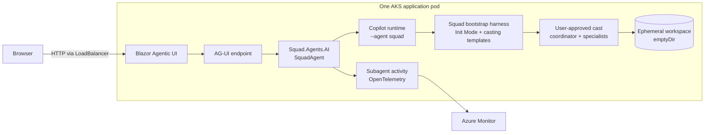

# Squad on AKS

**Run a real [Squad](https://github.com/bradygaster/squad) inside Azure Kubernetes Service and talk to it from a Blazor web application.**

Squad on AKS is a focused reference sample: one ASP.NET Core application, one AKS application pod, and one disposable repository workspace. The workspace starts without a cast. The browser asks what the Squad should do, uses Squad's native Init Mode to propose a team, lets the user refine and review the generated harness, and then streams real work once the user activates the cast.

The sample uses [`Squad.Agents.AI`](https://github.com/bradygaster/squad/tree/dev/src/Squad.Agents.AI) directly. Squad remains unchanged; this repository hosts it as a Microsoft Agent Framework `AIAgent` and presents it through the Blazor Agentic UI components.

```text
┌─ Cast your Squad ───────────────────────────────────────────────────────────┐
│ sample-api                                          AKS · Needs a cast     │
│                                                                            │
│ There is no Squad yet. What will this team be responsible for?             │
│                                                                            │
│ You                                                                        │
│ Maintain this .NET API. Implement small features, test them, and review     │
│ changes before presenting the result.                                      │
│                                                                            │
│ Squad                                                       Casting...     │
│ Proposed cast:                                                             │
│   FLIGHT — Lead       GNC — API specialist       TELMU — Tester            │
│   RETRO  — Reviewer   Scribe — Team memory                                  │
│                                                                            │
│ [Ask for changes] [Review harness files] [Accept cast and start Squad]      │
└────────────────────────────────────────────────────────────────────────────┘
```

> [!IMPORTANT]
> Wave 1 intentionally demonstrates the smallest useful experience. It does not provide durable conversations, pull request automation, multiple concurrent users, per-session Kubernetes Jobs, fleet management, or a production identity system. The complete requirements and acceptance criteria are tracked in [Wave 1: Run an interactive Squad in AKS with Blazor](https://github.com/bradygaster/squad-on-aks/issues/3).

## What you will build

The finished sample deploys:

- an **ASP.NET Core Blazor Web App** with the chat and activity experience;
- an in-process **AG-UI endpoint** backed by `Squad.Agents.AI`;
- the existing **Squad and Copilot runtime**, unchanged;
- a native Squad casting flow that begins with an empty roster;
- a bounded harness editor for the generated team, routing, and charter Markdown;
- an **ephemeral workspace** populated with a deterministic sample repository;
- health endpoints, structured logs, and OpenTelemetry traces;
- one container image in Azure Container Registry;
- one AKS application deployment with one replica;
- one public AKS `LoadBalancer` service and Azure Monitor-backed observability.

The result is a vertical slice, not a platform:



All application components run together in the same pod. There is no separate scheduler, queue, workflow database, worker service, or custom Squad protocol.

## Quickstart

### Prerequisites

Install:

- [Git](https://git-scm.com/downloads)
- [Azure CLI](https://learn.microsoft.com/cli/azure/install-azure-cli)
- [Azure Developer CLI](https://learn.microsoft.com/azure/developer/azure-developer-cli/install-azd)
- access to an Azure subscription where you can create a resource group, AKS cluster, container registry, and role assignments
- a Copilot-supported GitHub credential exported as `COPILOT_GITHUB_TOKEN`

The [Copilot SDK authentication documentation](https://github.com/github/copilot-sdk/blob/main/docs/auth/authenticate.md) lists supported credentials. For Wave 1, the credential is a sample deployment secret used by the single application instance. Do not use a classic `ghp_` personal access token; the Copilot SDK does not support it.

You do not need to install .NET, Node.js, `kubectl`, Helm, Squad, or the Copilot CLI for the standard deployment path. The build and container image carry the required runtime, and deployment hooks apply the Kubernetes resources through Azure CLI. Install `kubectl` only if you want to run the optional operations commands later in this guide.

### Timing

- **Human interaction:** three steps and normally under five minutes.
- **New Azure environment:** AKS and supporting resources can take 20-40 minutes to provision.
- **Existing environment:** an application-only redeployment normally completes in 5-10 minutes.

`azd up` streams progress. After Azure accepts the deployment, you can leave it running unattended and return to `azd show`.

### 1. Clone

```bash
git clone https://github.com/bradygaster/squad-on-aks.git
cd squad-on-aks
```

### 2. Authenticate and configure the sample credential

```bash
azd auth login
azd env set COPILOT_GITHUB_TOKEN "$COPILOT_GITHUB_TOKEN"
```

Expected:

```text
Logged in to Azure.
Environment value COPILOT_GITHUB_TOKEN set.
```

`azd` stores the local environment under `.azure/`, which is ignored by Git but still contains sensitive local configuration and must not be shared. The deployment writes the credential to the cluster as a Kubernetes Secret and exposes it only to the application container. Wave 1 does not implement user sign-in or per-user credentials.

### 3. Deploy

```bash
azd up
```

Select a subscription and location when prompted.

Expected:

```text
Provisioning Azure resources
  ✓ Resource group
  ✓ Azure Container Registry
  ✓ Azure Kubernetes Service
  ✓ Log Analytics and Application Insights

Building and publishing squad-on-aks
  ✓ Container image pushed
  ✓ Kubernetes Secret applied
  ✓ LoadBalancer assigned a public IP
  ✓ Deployment available: 1/1
  ✓ Readiness probe passed

SUCCESS: Squad on AKS is ready
Web:    http://<public-ip>/
Health: http://<public-ip>/health/ready
```

The public IP depends on the selected Azure environment. `azd show` prints it again later.

## Cast the Squad

Open the URL printed by `azd up`. The application reports healthy and the page shows **Needs cast** only after:

1. the pod-local workspace has been initialized;
2. `.github/agents/squad.agent.md` is present;
3. `SquadAgent` resolves successfully from dependency injection;
4. the Copilot runtime can start with the configured credential.

Application readiness means the app can begin casting; it does not mean a team already exists. The first page says:

```text
There is no Squad yet.

Describe what this Squad will work on. Squad will inspect the sample repository,
propose a cast, and wait for your approval before creating the team.
```

Use the included casting brief:

> Maintain this .NET API. Implement small features, test them, and review changes before presenting the result.

Squad's native Init Mode inspects the fixture and proposes a cast. No team files are written during the proposal phase.

```text
Proposed cast

FLIGHT  — Lead             Scope, decisions, code review
GNC     — API specialist   ASP.NET Core APIs and implementation
TELMU   — Tester           Tests, quality, edge cases
RETRO   — Reviewer         Review and maintainability
Scribe  — Team memory      Decisions and session history
```

The names vary with Squad's casting engine. Roles and responsibilities are the acceptance boundary.

Refine the proposal through the same chat:

```text
Make the tester focus on integration tests.
Add accessibility review to the reviewer's charter.
Remove any role that does not contribute to this API.
```

When the proposal is correct, accept it. Squad writes the native `.squad/` harness into the ephemeral workspace. The **Review cast** panel exposes only:

- `.squad/team.md`;
- `.squad/routing.md`;
- `.squad/agents/*/charter.md`.

The user may edit and save those Markdown files. The panel is not a general repository editor: it cannot browse or modify application source, casting registries, histories, logs, configuration outside the allowlist, or files outside `/workspace`.

Select **Start taking requests** after reviewing the harness. Until then, ordinary work prompts remain disabled. Activation validates that the roster has members, every referenced charter exists, and routing names only active members. It does not call a model.

## First work request

After activation, use the included acceptance prompt:

> Ask the API specialist to inspect this repository, add a `/health` endpoint with a test, and have the reviewer check the result.

The chat response streams as it is produced. The activity panel separately reports coordinator and specialist events:

```text
00:00  coordinator  Planning the request
00:03  api          Specialist started
00:11  api          Inspecting the sample API
00:37  api          Implementation complete
00:39  reviewer     Specialist started
00:54  reviewer     Review complete
00:55  coordinator  Final response complete
```

The workspace panel then shows concrete evidence:

```text
Active cast
  FLIGHT · Lead      GNC · API specialist
  TELMU · Tester     RETRO · Reviewer

Generated harness
  A .squad/team.md
  A .squad/routing.md
  A .squad/agents/gnc/charter.md
  ...

Application changes
  M src/Api/Program.cs
  A tests/Api.Tests/HealthEndpointTests.cs

Validation
  dotnet test
  Passed: 18 · Failed: 0 · Skipped: 0
```

Send a follow-up in the same browser session:

> Explain the implementation and why the test proves the endpoint is healthy.

The response uses the preceding conversation and current workspace. Conversation state is scoped to the running application instance and is not durable across pod replacement.

## How the application works

The application registers the Squad package as the agent implementation:

```csharp
builder.Services.AddSquadAgent(options =>
{
    options.SquadFolderPath = "/workspace";
    options.OnSubagentTrace = activityFeed.Record;
});
```

The Microsoft Agent Framework/AG-UI hosting integration exposes that agent to the Blazor application. The UI uses `AGUIChatClient` and the Blazor AI components to render streaming messages and typed interaction state.

```mermaid
sequenceDiagram
    actor User
    participant UI as Blazor UI
    participant AGUI as AG-UI endpoint
    participant Agent as SquadAgent
    participant Squad as Squad coordinator
    participant Specialist as Squad specialist
    participant Workspace as /workspace

    UI-->>User: No Squad yet — describe its purpose
    User->>UI: Submit casting brief
    UI->>AGUI: Start Init Mode turn
    AGUI->>Agent: RunStreamingAsync
    Agent->>Squad: Start Copilot session with --agent squad
    Squad->>Workspace: Inspect fixture
    Squad-->>UI: Propose cast; write nothing
    User->>UI: Refine roles and accept
    UI->>Squad: Confirm proposal
    Squad->>Workspace: Write native .squad harness
    UI-->>User: Review allowed harness files
    User->>UI: Activate cast
    UI->>Workspace: Validate roster, routing, and charters
    UI-->>User: Squad ready
    User->>UI: Submit work request
    UI->>AGUI: Continue streamed conversation
    Squad->>Specialist: Delegate API work
    Specialist->>Workspace: Inspect, edit, and test
    Specialist-->>Agent: Subagent lifecycle events
    Agent-->>UI: Activity updates
    Squad-->>UI: Stream final response
    UI->>Workspace: Read changed-file and validation summary
    UI-->>User: Conversation + evidence
```

### Squad bootstrap and casting

The image contains the coordinator harness and Init Mode assets, but no populated team:

```text
/workspace/.github/agents/squad.agent.md
/workspace/.squad/templates/
/workspace/.squad/skills/coordinator-init-mode/SKILL.md
```

The first conversation runs Squad's two-phase Init Mode: propose and wait, then create only after confirmation. The resulting roster, routing rules, charters, histories, and casting state are Squad's native files—not a second application-specific team format.

After activation, the coordinator delegates implementation and validation to the cast members. The application does not simulate these events: the activity panel consumes `Squad.Agents.AI` subagent trace callbacks, and the same dispatches appear as `squad.subagent` OpenTelemetry spans.

### Ephemeral workspace

An init container copies the deterministic sample repository into an `emptyDir` volume mounted at `/workspace`. Squad can read, edit, build, and test only that disposable copy.

```yaml
volumes:
  - name: workspace
    emptyDir:
      sizeLimit: 2Gi
```

Deleting the pod deletes its cast, conversation, and uncommitted workspace. The replacement pod receives a clean uncast fixture and asks the user to cast again. Wave 1 deliberately does not persist the generated harness, branches, commits, conversation state, or application changes.

### Permissions

`Squad.Agents.AI` currently configures the Copilot runtime for permissive tool execution by default. Wave 1 contains that behavior with:

- one trusted demonstration user;
- one deterministic fixture repository;
- one pod-local `emptyDir` workspace;
- no host filesystem mount;
- one application replica;
- Kubernetes CPU, memory, and ephemeral-storage limits;
- no production repository credentials.

Do not point this sample at untrusted repositories or expose it as a multi-user service. Interactive approvals and stricter runtime policy are later hardening work, not hidden Wave 1 capabilities.

## What `azd up` provisions

| Resource | Purpose |
|---|---|
| Azure Kubernetes Service | Hosts the single application pod and its ephemeral workspace |
| Azure Container Registry | Stores the pinned application image |
| Log Analytics and Application Insights | Receives application logs, traces, and `squad.subagent` activities |
| Managed identity and role assignments | Lets AKS pull the image and send telemetry |

The deployment also applies:

- one Kubernetes Deployment with `replicas: 1`;
- one `emptyDir` workspace;
- one Kubernetes Secret containing `COPILOT_GITHUB_TOKEN`;
- liveness and readiness probes;
- resource requests and limits;
- one public `LoadBalancer` service.

No Front Door profile, ingress controller, TLS certificate, SQL database, message broker, Blob account, Redis cache, KEDA scaler, API gateway, or separate control service is created.

## Application states

The UI uses a small, truthful state model:

| State | Meaning |
|---|---|
| **Starting** | The pod or Copilot runtime is initializing. Chat is unavailable. |
| **Needs cast** | The application is healthy, but the workspace has no populated Squad roster. Only a casting brief is accepted. |
| **Casting** | Squad is proposing or refining the team. No harness files are written before confirmation. |
| **Cast review** | The native harness exists and may be edited through the fixed Markdown allowlist. Work requests remain disabled. |
| **Ready** | The reviewed cast passed local validation and the application can accept work. |
| **Working** | A conversation turn is active and streaming. |
| **Waiting** | The agent is waiting for the next user message. |
| **Cancelling** | The application has requested cancellation and is waiting for the active run to stop. |
| **Cancelled** | The active turn stopped without being reported as successful. |
| **Failed** | Startup or the active turn failed. The UI shows the actual error category. |

Pod deletion is not shown as a successful or cancelled conversation. The browser reports that the application disconnected and reconnects when the replacement pod reaches **Needs cast**.

## Operations

### Show the deployed URL and resources

```bash
azd show
```

### Check the application

```bash
kubectl get deployment,pod,service -n squad-on-aks
kubectl wait --for=condition=available deployment/squad-on-aks \
  --namespace squad-on-aks \
  --timeout=180s
```

Expected:

```text
deployment.apps/squad-on-aks   1/1   1   1
pod/squad-on-aks-...           1/1   Running
service/squad-on-aks                  <public address>
```

### Read logs

```bash
kubectl logs deployment/squad-on-aks \
  --namespace squad-on-aks \
  --follow
```

Logs include application startup, workspace initialization, chat-run boundaries, specialist lifecycle events, and validation summaries. Credential values and request authorization headers are not logged.

### Inspect traces

Open the Application Insights resource printed by `azd show`, then query:

```kusto
dependencies
| where name startswith "squad.subagent"
| project timestamp, operation_Id, name, customDimensions
| order by timestamp asc
```

A successful acceptance run includes at least one `squad.subagent` span. A convincing final response without that span does not satisfy the Wave 1 delegation requirement.

### Prove the workspace is disposable

```bash
kubectl exec deployment/squad-on-aks -n squad-on-aks -- \
  git -C /workspace status --short

kubectl delete pod -n squad-on-aks \
  -l app.kubernetes.io/name=squad-on-aks

kubectl rollout status deployment/squad-on-aks \
  -n squad-on-aks

kubectl exec deployment/squad-on-aks -n squad-on-aks -- \
  git -C /workspace status --short
```

The first status shows the files changed during the conversation. The final status is clean because the replacement pod received a new `emptyDir`.
The replacement UI returns to **Needs cast** because the generated team was intentionally ephemeral.

### Redeploy

```bash
azd up
```

The deployment rebuilds the image when source changed and reconciles the existing Azure resources and Kubernetes objects.

### Cleanup

```bash
azd down --purge
```

Review the resource group named by `azd` before confirming deletion.

## Troubleshooting

| Symptom | Check | Resolution |
|---|---|---|
| Readiness remains false | `kubectl logs deployment/squad-on-aks -n squad-on-aks` | Confirm the token is configured and the Squad files were copied into `/workspace`. |
| Authentication failed | `azd env get-values` and pod logs | Supply a Copilot-supported credential as `COPILOT_GITHUB_TOKEN`, then run `azd up` again. |
| The page loads but chat is disabled | Open `/health/ready` | Resolve the named agent or Copilot startup failure; the UI does not enable chat on degraded startup. |
| Casting brief does not produce a proposal | Inspect logs for Init Mode and AG-UI interaction events | Confirm the bootstrap has no populated roster and the coordinator Init Mode skill is discoverable. Do not add a custom casting engine as a fallback. |
| Team files appear before confirmation | Run the casting contract test | Treat this as a failure: Phase 1 must propose and stop without writing the harness. |
| **Start taking requests** remains disabled | Open the cast validation details | Correct missing charters, unknown routing members, or malformed roster entries in the allow-listed editor. |
| No specialist activity appears | Inspect Application Insights for `squad.subagent` | Confirm the sample uses the Squad agent definition and the prompt explicitly delegates to a specialist. |
| Changes disappear | Check the pod age | This is expected after pod replacement; Wave 1 uses an ephemeral workspace. |
| Conversation context disappears | Check whether the pod restarted | Conversation persistence is outside Wave 1. Start a new conversation. |
| Pod is `Pending` | `kubectl describe pod -n squad-on-aks -l app.kubernetes.io/name=squad-on-aks` | Check regional quota and node capacity. |
| Image cannot be pulled | `kubectl describe pod ...` | Verify the AKS managed identity has `AcrPull` on the registry. |
| Public endpoint is not ready | `azd show` and `kubectl get service -n squad-on-aks` | Wait for the `LoadBalancer` service to receive an external IP and inspect its events if the address remains pending. |

## Repository layout

```text
.
├── README.md
├── azure.yaml                         # Azure Developer CLI project
├── infra/
│   ├── main.bicep                     # AKS, ACR, identity, and monitoring
│   └── modules/
├── deploy/
│   └── kubernetes/
│       ├── namespace.yaml
│       ├── deployment.yaml
│       └── service.yaml
├── src/
│   └── SquadOnAks.Web/
│       ├── Components/                # Blazor chat, activity, and workspace views
│       ├── Agents/                    # Squad registration and AG-UI mapping
│       ├── Observability/             # Subagent activity and OpenTelemetry
│       ├── Workspace/                 # Initialization and evidence summaries
│       ├── Program.cs
│       └── Dockerfile
├── sample/
│   ├── repository/                    # Deterministic API fixture
│   └── squad/
│       ├── .github/agents/squad.agent.md
│       └── .squad/                    # Init Mode skill, templates, and empty roster
└── tests/
    ├── SquadOnAks.Web.Tests/
    └── acceptance/
```

## Architecture decisions

### Why AKS

The purpose of the sample is to make a Squad an observable, containerized Kubernetes workload. AKS provides the pod, workspace volume, health probes, resource boundaries, rollout behavior, logs, and deletion semantics the sample intends to teach. A serverless host could run the application with less infrastructure, but it would not demonstrate the AKS hosting model.

### Why `Squad.Agents.AI`

`Squad.Agents.AI` already exposes the existing Squad coordinator as a Microsoft Agent Framework `AIAgent`, including streaming and typed subagent telemetry. Using it keeps Squad unchanged and avoids inventing a second runtime or proprietary bridge.

### Why casting is part of Wave 1

Casting is Squad's native first-run experience. Starting with a prebuilt team would prove that an agent can run in AKS, but it would skip how a user actually creates a Squad for a repository. Wave 1 therefore begins with Squad's own two-phase Init Mode and exposes the generated Markdown harness for review before work starts.

This does not authorize a second casting implementation. The application supplies presentation, an allow-listed editor, local validation, and an activation gate; Squad remains responsible for proposing and creating the team.

### Why Blazor Agentic UI

The Blazor AI components provide a .NET-native surface for streaming messages, structured activity, and future interactive agent experiences. The Microsoft Agent Framework AG-UI hosting adapter lets the web application expose the same `SquadAgent` without translating it into a custom protocol.

The Blazor AI components and MAF AG-UI ASP.NET hosting integration are preview dependencies. The repository pins their versions, isolates their use behind small adapter classes, and treats package upgrades as deliberate changes.

### Why one application pod

One pod keeps the first sample understandable. The web application, agent host, runtime, Squad configuration, and workspace share one lifecycle. This is not a high-availability design, but it is the shortest path to proving the experience end to end.

### Why a plain LoadBalancer

Wave 1 exposes the Blazor application directly through an AKS `LoadBalancer` service. This avoids adding Front Door, DNS, certificate management, or an ingress controller to a sample whose purpose is to demonstrate Squad running in AKS.

The endpoint uses HTTP and is intended only for a temporary, single-user demonstration. The Copilot credential remains server-side and is never sent to the browser. HTTPS, custom domains, user authentication, and public multi-user exposure are later hardening work.

### Why an ephemeral workspace

An ephemeral fixture makes permissive agent execution bounded and makes cleanup obvious. It also keeps Wave 1 focused on hosting and interaction rather than repository credentials, persistence, reconciliation, and pull request automation.

## Delivery milestones

Wave 1 is delivered in four gated milestones. A milestone is complete only when every listed exit check passes. Work for a later milestone does not begin early to "prepare the architecture."

| Milestone | Goal | Measurable exit |
|---|---|---|
| **1. Local casting and conversation** | Prove `Squad.Agents.AI` carries Squad's native Init Mode through MAF/AG-UI. | One local Blazor process starts uncast, accepts a project brief, presents a native cast proposal without writing team files, accepts one refinement and confirmation, writes the native harness, validates explicit activation, streams a work request, dispatches a cast specialist, and accepts one contextual follow-up. |
| **2. Disposable workload** | Prove the cast and useful work have truthful lifecycle behavior inside one container. | The image starts in **Needs cast**, reports healthy without making a model call, creates and edits only allow-listed harness files, completes the known fixture task and test command, cancels one active turn, and returns to **Needs cast** with a clean fixture after replacement. |
| **3. AKS deployment** | Prove the same image runs in the minimum Azure topology. | `azd up` provisions only the documented resources, deploys one replica, assigns a public IP, passes readiness, streams a real response, and emits a `squad.subagent` span to Application Insights. |
| **4. First-user acceptance** | Prove the documented experience from a fresh checkout. | A first-time user completes the three-step quickstart, casts and refines a Squad, activates it, runs the full work conversation, verifies that replacement removes both cast and work, reads logs and traces, and removes the environment with `azd down --purge`. |

If a milestone fails, fix that vertical slice. Do not add queues, databases, controllers, persistence, identity systems, or alternate execution paths as a workaround.

## Units of work

Each implementation unit has one bounded result and one objective completion check.

| Unit | Deliverable | Completion check | Explicitly not part of the unit |
|---|---|---|---|
| **1. Pin the application stack** | Minimal Blazor project with exact .NET, Blazor AI, MAF, AG-UI, Copilot SDK, and `Squad.Agents.AI` versions. | A clean restore and build succeeds; the lock or central package file contains no floating versions. | Aspire orchestration, a component library, theming, authentication, or deployment code. |
| **2. Host the real Squad** | Register one `SquadAgent` against the bundled coordinator harness and empty roster. | A local smoke run proves the `squad` definition and Init Mode skill loaded; missing bootstrap files fail explicitly instead of selecting a generic agent. | ACP bridges, custom protocols, multiple Squads, pre-cast teams, or arbitrary repositories. |
| **3. Carry native casting through the UI** | Uncast, proposal, refinement, confirmation, cast review, and activation flow over the same AG-UI conversation. | Before confirmation no team files exist; after confirmation Squad's native roster, routing, charters, and casting state exist; a failed native confirmation flow blocks the unit rather than triggering a custom casting engine. | Reimplementing `CastingEngine`, a second team schema, custom role generation, or bypassing Squad Init Mode. |
| **4. Review the generated harness** | Allow-listed Markdown editor for `team.md`, `routing.md`, and active charters. | Saving an allowed file succeeds; path traversal and every non-allow-listed path are rejected; activation validates roster, routing, and charter references locally. | General file browsing, source editing, diffs, history, registry editing, or a full IDE. |
| **5. Stream one work conversation** | One chat page backed by the in-process AG-UI endpoint after activation. | The first work response renders incrementally and one follow-up uses the active conversation context. | Conversation lists, durable history, reconnect recovery, multiple concurrent conversations, or collaboration features. |
| **6. Show real delegation** | Activity list fed by `OnSubagentTrace` and OpenTelemetry. | The acceptance request names a cast implementation specialist in the UI and produces a matching `squad.subagent` activity. | A general workflow visualizer, custom dashboards, cost accounting, notifications, or SquadHub-style fleet views. |
| **7. Prepare the fixture workspace** | Deterministic sample API plus Squad bootstrap assets copied into `/workspace`. | Startup produces a clean, uncast Git worktree; the known health-endpoint task can modify it and `dotnet test` can validate it after casting. | Cloning user repositories, GitHub credentials, branches, commits, pull requests, PVCs, or workspace recovery. |
| **8. Report bounded evidence** | Workspace panel showing the cast summary, `git status --short`, and the known test result. | Active cast roles, expected changed paths, and pass/fail counts appear after the acceptance run. | A generalized evidence store, artifact upload, SARIF pipeline, source diff editor, or arbitrary command history. |
| **9. Implement lifecycle and health** | Starting, Needs cast, Casting, Cast review, Ready, Working, Waiting, Cancelling, Cancelled, and Failed states plus health endpoints. | Automated tests cover every transition; readiness and cast activation perform only local checks and never consume model credits. | Durable state machines, distributed cancellation, rollback of file edits, approval workflows, or reconciliation. |
| **10. Build the image** | One image containing the web app, runtime, coordinator harness, casting assets, and fixture seed. | The container becomes healthy in **Needs cast**, completes casting and work, and a replacement returns to **Needs cast** with a clean workspace. | Separate web and worker images, additional containers beyond fixture initialization, image variants, or runtime downloads on pod startup. |
| **11. Add minimum observability** | Structured console logs plus standard Azure Monitor OpenTelemetry export. | `kubectl logs` shows casting and run boundaries; Application Insights contains the correlated `squad.subagent` span. | Custom collectors, Grafana, dashboards, alerts, cost models, or a telemetry data platform. |
| **12. Deploy the minimum topology** | `azd`, Bicep, and Kubernetes resources for AKS, ACR, monitoring, one Secret, one Deployment, and one LoadBalancer Service. | A fresh `azd up` reaches `1/1` healthy in **Needs cast** and prints a working public HTTP URL. | Front Door, ingress, DNS, TLS, Key Vault, private networking, autoscaling, Helm, operators, KEDA, or multiple node pools. |
| **13. Prove and document acceptance** | Automated local checks and one opt-in live AKS smoke path matching this README. | Casting, harness refinement, activation, work, delegation, replacement reset, and `azd down --purge` all pass. | CI deployment on every change, load tests, chaos testing, performance tuning, or production certification. |

## Scope-control rules

These rules apply during planning, implementation, review, and Squad delegation:

1. **Every task names its acceptance criterion.** If work cannot point to an unchecked Wave 1 criterion or unit above, it is not Wave 1 work.
2. **One path only.** Implement the documented Blazor + AG-UI + `Squad.Agents.AI` path. Do not add fallback agents, alternate protocols, alternate deployment targets, or a second UI.
3. **Casting remains Squad-native.** The application may present, edit, validate, and activate Squad's files, but must not reimplement role proposal, universe selection, naming, charter generation, or casting state.
4. **No speculative abstractions.** Extract a reusable abstraction only when two Wave 1 call sites already need it. Future extensibility is not an acceptance criterion.
5. **No production hardening by implication.** Record a limitation instead of adding identity, approvals, persistence, private networking, TLS, scaling, reconciliation, or secret-management systems.
6. **The fixture is the repository boundary.** Wave 1 never accepts a repository URL, GitHub installation, branch, or pull request destination.
7. **One active conversation.** A second browser may view the page, but the application accepts only one active conversation and one active turn. It returns a clear busy response rather than creating a scheduler.
8. **Cancellation is local.** Stop cancels the current in-process run and reports the result. It does not undo file edits or promise distributed containment.
9. **Readiness is free.** Health probes check configuration, files, dependency resolution, and process readiness; they do not call a model or run the acceptance prompt.
10. **Telemetry stays standard.** Use built-in logging and OpenTelemetry exporters. Do not build dashboards or a second event store.
11. **Infrastructure has a fixed budget.** The baseline may contain only the Azure and Kubernetes resources named in Unit 12. Adding a resource requires changing the Wave 1 issue first and naming the existing criterion that cannot otherwise pass.
12. **Tests prove behavior, not prose.** Casting requires a proposal-before-write gate and native harness files; delegation requires a subagent event/span; useful work requires changed files and a passing command; ephemerality requires a clean uncast replacement workspace.
13. **Stop when the criterion passes.** Refactoring, polishing, or extending an already-passing unit requires a demonstrated defect in another Wave 1 criterion.

During Squad execution, the coordinator must give each specialist one unit from the table, its completion check, and its explicit exclusions. Specialists must not create follow-on work or implement adjacent improvements without a failing Wave 1 criterion.

### Known scope-creep traps

| Tempting enhancement | What it would pull in | Wave 1 mitigation |
|---|---|---|
| "Secure the public app properly" | Login, OAuth, Front Door, TLS, DNS, Key Vault, authorization, and user isolation | Keep a temporary single-user HTTP endpoint, never send the server credential to the browser, document the limitation, and destroy the environment after use. |
| "Let users choose a repository" | GitHub identity, installation tokens, clone policy, branch management, persistence, and PR workflows | Ship exactly one fixture in the image. There is no repository picker or repository URL input. |
| "Build a better casting service" | A second role model, name allocator, charter generator, team schema, and migration path | Use Squad's native Init Mode and native files. If the flow cannot cross AG-UI, stop the milestone and fix or report that integration boundary. |
| "Make permissive tools production-safe" | Permission UX, policy engines, audit records, and reconciliation | Bound execution to the disposable fixture and explicitly prohibit untrusted or multi-user use. Approval work is a later wave. |
| "Resume after a restart" | Database-backed conversations, workspace persistence, session ownership, migrations, and recovery | A pod restart starts clean. The UI says the conversation was lost. |
| "Support a few simultaneous users" | Session routing, concurrency controls, quotas, scheduling, and isolation | Accept one active conversation and return `409 Conflict` with a visible busy message for another. |
| "Run each chat in its own Job" | A control plane, Job creation API, bidirectional routing, lifecycle reconciliation, and cleanup controllers | Keep the conversation and Squad process in the one application pod for Wave 1. |
| "Improve the operator experience" | Session lists, dashboards, notifications, filtering, history, and fleet management | Provide one page with casting, allow-listed harness review, chat, activity, workspace summary, health, and Stop—nothing else. |
| "Preserve better evidence" | Blob Storage, schemas, retention, checksums, immutable manifests, and authorization | Show only current `git status --short` and the known test result. Evidence disappears with the pod. |
| "Make telemetry production-grade" | Collectors, dashboards, alerts, sampling policy, cost attribution, and long-term storage | Export standard logs and traces to Application Insights and document one query. |
| "Make deployment flexible" | Helm, environment matrices, alternate clouds, existing-cluster modes, autoscaling, and multiple node pools | Support one `azd up` path, one region choice, one node pool, one replica, and one Kubernetes manifest set. |
| "Improve secret management" | Key Vault, CSI drivers, workload identity, rotation, and per-user tokens | Use one Kubernetes Secret populated by `azd`; document that it is sample-grade and short-lived. |
| "Future-proof the integration" | Custom protocols, adapters, plugin systems, interfaces, and alternate agent runtimes | Call `Squad.Agents.AI` directly. Add an abstraction only after two current Wave 1 call sites require it. |
| "Fully automate acceptance" | Persistent test subscriptions, CI credentials, recurring cloud cost, and flaky live-model gates | Keep deterministic local tests in normal CI and one explicit, opt-in live AKS smoke run. |

## Wave 1 boundaries

Wave 1 does not include:

- GitHub App or end-user identity architecture;
- pull request creation;
- durable conversations or durable workspaces;
- multiple concurrent users or horizontally scaled application replicas;
- per-session Kubernetes Jobs;
- multiple-Squad scheduling, fairness, quotas, or workload classes;
- SQL, Service Bus, Blob Storage, Redis, KEDA, APIM, or a durable control plane;
- remote ACP control, device management, approval inboxes, Teams, or push notifications;
- Front Door, ingress controllers, custom DNS, TLS certificates, or HTTPS termination;
- production-grade secret rotation, private networking, or enterprise hardening.

These are potential later waves only when the working sample demonstrates a specific need.

## Done means this works end to end

Wave 1 is complete when all of the following are continuously demonstrated:

- A first-time user can clone the repository, authenticate/configure, and submit deployment in three manual steps and under five minutes of human interaction.
- Azure provisioning can continue asynchronously and reports observable progress.
- The deployed application becomes available at one public HTTP URL.
- Readiness remains false until the workspace, coordinator harness, Init Mode assets, `SquadAgent`, and Copilot runtime are usable; a populated roster is not required for application readiness.
- Chat uses a real `Squad.Agents.AI` agent and `.github/agents/squad.agent.md`, not a simulated or generic fallback.
- An uncast workspace opens in **Needs cast** and accepts only a casting brief.
- The first interaction uses Squad's native Init Mode, streams a proposal, and writes no team files before user confirmation.
- The user can refine the proposal conversationally, confirm it, edit only the allow-listed native harness files, and explicitly activate the cast.
- A malformed roster, missing charter, invalid routing member, or edit outside the allowlist blocks activation with a visible error.
- The first work response streams into the Blazor UI only after activation.
- A follow-up message retains the active browser session's conversation context.
- The acceptance prompt dispatches at least one real specialist.
- The UI displays named specialist activity and Application Insights contains the matching `squad.subagent` span.
- Squad edits the sample repository and produces a changed-file list plus passing validation evidence.
- Missing credentials, agent startup failures, and validation failures remain visible failures.
- Deleting the pod removes the generated cast and modified workspace.
- The replacement pod starts from a clean fixture in **Needs cast**.
- Logs, traces, redeployment, troubleshooting, and cleanup work as documented.

The concise finish line is:

> **One pod, one user-cast Squad, one web conversation, real delegation, real workspace work, observable and disposable on AKS.**

## References

- [Wave 1 requirements and acceptance criteria](https://github.com/bradygaster/squad-on-aks/issues/3)
- [Squad](https://github.com/bradygaster/squad)
- [Squad team setup and Init Mode](https://github.com/bradygaster/squad/blob/dev/docs/src/content/docs/features/team-setup.md)
- [`Squad.Agents.AI`](https://github.com/bradygaster/squad/tree/dev/src/Squad.Agents.AI)
- [Build agentic user interfaces with Blazor](https://devblogs.microsoft.com/dotnet/build-agentic-ui-blazor/)
- [Microsoft Agent Framework](https://github.com/microsoft/agent-framework)
- [AG-UI protocol](https://docs.ag-ui.com/)
- [GitHub Copilot SDK authentication](https://github.com/github/copilot-sdk/blob/main/docs/auth/authenticate.md)
- [Azure Kubernetes Service](https://learn.microsoft.com/azure/aks/)
- [Kubernetes services in AKS](https://learn.microsoft.com/azure/aks/concepts-network-services#services)
- [Azure Developer CLI](https://learn.microsoft.com/azure/developer/azure-developer-cli/)
- [Azure Monitor OpenTelemetry](https://learn.microsoft.com/azure/azure-monitor/app/opentelemetry-enable)
