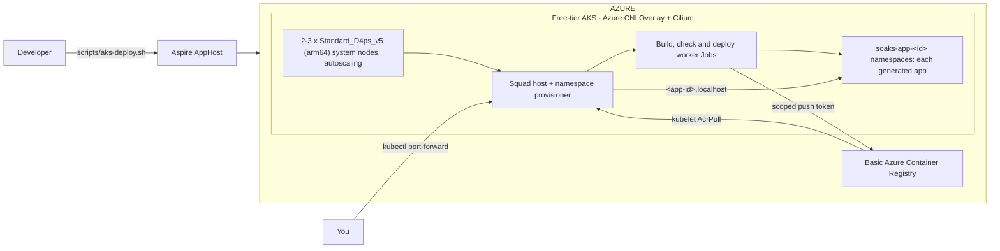

# AKS deployment and operations

This runbook deploys the Squad on AKS platform. Generic production hosting
for generated apps remains separate work in
[#51](https://github.com/bradygaster/squad-on-aks/issues/51).
The recorded topology is a deployment proof, not a production ingress or
authentication design. Run commands from the repository root.

For an existing local cluster, use [Local Kubernetes](local-kubernetes.md).

## Current architecture



- **Private.** Squad has no sign-in and holds your GitHub token, so its Service
  is `ClusterIP` and you reach it through `kubectl port-forward`. The cluster
  API accepts only the addresses in `SOAKS_AKS_AUTHORIZED_IPS` (by default the
  deploying machine's public address).
- **Squad is the ingress for apps.** Every online app is served on its own
  origin, `http://<app-id>.localhost:<port>/`, through the same port-forward
  (browsers send `*.localhost` to your machine). No Azure ingress, gateway or
  DNS is involved.
- **arm64 nodes** run the same images proven on Docker Desktop on Apple silicon.
- **Cilium enforces the NetworkPolicies** Squad relies on (no network for
  builds, per-app boundaries).

## Deploy from a fresh clone

The deployment creates billable Azure resources: two `Standard_D4ps_v5`
nodes (up to three), a Basic ACR, a few small disks and an outbound IP.

### Prerequisites

Install and configure:

- [Git](https://git-scm.com/);
- [.NET SDK 10.0.301](https://dotnet.microsoft.com/download), pinned by
  [`global.json`](../global.json), then `dotnet tool restore`;
- [Azure CLI](https://learn.microsoft.com/cli/azure/install-azure-cli), logged in;
- [GitHub CLI](https://cli.github.com/), logged in (its token is Squad's
  Copilot and GitHub credential);
- Docker Desktop (or another Docker runtime with buildx);
- [`kubectl`](https://kubernetes.io/docs/tasks/tools/) and
  [Helm](https://helm.sh/docs/intro/install/) 4.2.0 or later; and
- an Azure subscription where you can create a resource group, AKS, ACR and
  role assignments, with quota for 8-12 `Standard DPSv5 Family` vCPUs in the
  region.

### Deploy

```bash
az account set --subscription "<subscription-name-or-id>"
export Azure__SubscriptionId="$(az account show --query id -o tsv)"
./scripts/aks-deploy.sh
```

Optional settings: `Azure__ResourceGroup` (default `rg-squad-on-aks`),
`Azure__Location` (default `westus2`), `SOAKS_NUGET_SOURCE` and
`SOAKS_NPM_REGISTRY` (package feeds for image builds, when nuget.org or npmjs
is not reachable from your network), `SOAKS_WORKER_IMAGE` (an already pushed
worker image) and `SOAKS_AKS_AUTHORIZED_IPS`.

The script can be rerun at any time. It:

1. provisions AKS and its registry on the first run (Aspire's Bicep, several
   minutes);
2. builds the worker image for arm64, pushes it to the registry and pins it by
   digest;
3. creates a push-only registry token for the deploy worker and stores it only
   in the cluster, as Secret `soaks-registry-push`;
4. deploys Squad with `aspire deploy` and waits for the rollout; and
5. prints the port-forward command and the worker image it used.

### Open Squad

```bash
KUBECONFIG="${TMPDIR:-/tmp}/squad-on-aks-kubeconfig" \
  kubectl -n default port-forward --address 127.0.0.1 service/app-service 58090:80
```

Browse to <http://127.0.0.1:58090/>. Use `127.0.0.1` for Squad itself and
`<app-id>.localhost` for apps, so the two are separate sites.

Run the smoke check against it:

```bash
Parameters__deployment_target=aks SQUAD_APP_URL=http://127.0.0.1:58090 \
  KUBECONFIG="${TMPDIR:-/tmp}/squad-on-aks-kubeconfig" ./scripts/aks-smoke.sh
```

It checks that every Service is internal, one replica of Squad and the
dashboard is ready, no ingress, gateway, certificate, autoscaler or extra
volume exists, health endpoints answer, and the initial state is
**Needs cast**.

### End-to-end proof on AKS

The opt-in shape runner drives the real UI against the AKS port-forward:

```bash
KUBECONFIG="${TMPDIR:-/tmp}/squad-on-aks-kubeconfig" E2E_SHAPE=1 E2E_APP=S0 \
  E2E_KUBE_CONTEXT="$(KUBECONFIG="${TMPDIR:-/tmp}/squad-on-aks-kubeconfig" kubectl config current-context)" \
  SQUAD_APP_URL=http://127.0.0.1:58090 E2E_BROWSER_CHANNEL=chrome \
  node test/e2e-local/verify.mjs
```

## Open the internal Aspire dashboard

The dashboard intentionally has no public IP:

```bash
kubectl port-forward \
  --namespace default \
  service/aks-dashboard-service \
  18888:18888
```

Open <http://127.0.0.1:18888>. If the dashboard asks for a token, retrieve the
startup output:

```bash
kubectl logs \
  --namespace default \
  --selector app.kubernetes.io/component=aks-dashboard \
  --tail 50
```

Do not publish the dashboard Service or its login token.

## Diagnose the application

For a local AppHost, use Aspire for resource state, console output, structured
logs, and traces:

```bash
dotnet aspire ps
dotnet aspire describe app
dotnet aspire logs app
dotnet aspire otel logs app
dotnet aspire otel traces app
```

Aspire's local backchannel is scoped to the running AppHost; it does not
inspect a deployed AKS cluster. In AKS, inspect application state and
structured container output with Kubernetes, and use the internal dashboard
above for traces:

```bash
kubectl get deployments,pods,services --namespace default
kubectl logs \
  --namespace default \
  deployment/app-deployment \
  --all-containers=true \
  --tail=100
```

To query the dashboard telemetry API with Aspire CLI instead of its UI, keep
the dashboard port-forward running and set `DASHBOARD_URL` to its dashboard
base or login URL without printing the login token:

```bash
dotnet aspire otel logs --dashboard-url "$DASHBOARD_URL"
dotnet aspire otel traces --dashboard-url "$DASHBOARD_URL"
```

## What the AppHost provisions

| Resource | Current configuration |
|---|---|
| Resource group | `Azure__ResourceGroup` |
| AKS control plane | Free tier; API limited to `SOAKS_AKS_AUTHORIZED_IPS`; OIDC issuer and workload identity enabled |
| AKS networking | Azure CNI Overlay, Cilium data plane and network policy |
| AKS node pool | `system`: `Standard_D4ps_v5` (arm64), autoscaling 2-3 |
| ACR | Basic SKU; nodes pull with the kubelet identity's AcrPull role |
| Squad host | One replica on the system pool, `Recreate` rollout (its workspace disk attaches to one node at a time) |
| Squad Service | Internal `ClusterIP`, port 80 → 8080 |
| Namespace provisioner | One replica on the system pool, internal `ClusterIP` |
| Dashboard Service | Internal `ClusterIP` |
| Workspace | PVC `soaks-workspace`, 32 Gi, default storage class, kept on uninstall |
| Worker Jobs | Run beside the host (they mount its workspace disk); builds have no network |
| Registry push | Secret `soaks-registry-push` (scoped ACR token), read only by deploy Jobs |
| Runtime boundary | UID/GID `1654`, read-only root filesystem, no privilege escalation, all Linux capabilities dropped, runtime-default seccomp |
| Squad requests/limits | `50m`/`2` CPU, `512Mi`/`4Gi` memory, `1Gi`/`2Gi` ephemeral storage |
| Secret | `app-secrets`, holding the Copilot/GitHub token |

The deployment does **not** create ingress, TLS, DNS, Application Gateway for
Containers, Front Door, a VNet customization, KEDA, Application Insights, or an
additional node pool.

## Preview the generated deployment

Generate the Aspire-owned Bicep and Helm artifacts without creating Azure
resources:

```bash
export Parameters__copilot_token="<copilot-supported-token>"
dotnet aspire publish --output-path ./artifacts/aspire --non-interactive
```

The output includes:

```text
artifacts/aspire/
├── main.bicep
├── aks/
│   └── aks.bicep
├── aks-acr/
│   └── aks-acr.bicep
├── Chart.yaml
├── values.yaml
└── templates/
```

Published artifacts are for review or handoff. `aspire deploy` resolves and
applies the AppHost model directly; it does not deploy from that output
directory.

## Redeploy

Rerun `./scripts/aks-deploy.sh`. It reuses the cluster, registry, worker
image build cache and registry token, then upgrades Squad in about a minute.

## Clean up

Make sure `KUBECONFIG` still points to credentials for the Aspire-owned AKS
cluster:

```bash
kubectl cluster-info
helm status production --namespace default
```

Then run the Aspire destroy pipeline:

```bash
dotnet aspire destroy --non-interactive --yes
```

Expected:

```text
✓ Helm release production uninstalled
✓ Resource group deletion in progress
✓ Deployment state cleared
✓ 11/11 steps succeeded
```

Azure resource-group deletion continues asynchronously. Wait for completion:

```bash
az group wait \
  --name "$Azure__ResourceGroup" \
  --deleted \
  --interval 15 \
  --timeout 1200

az group exists --name "$Azure__ResourceGroup"
```

The final command should print `false`.
Treat the destroy pipeline's explicit Helm-release-uninstalled result and the
absent resource group as the cleanup pass criteria; do not substitute
out-of-band resource deletion for Aspire teardown.

> [!CAUTION]
> `aspire destroy --yes` deletes the configured Aspire-owned resource group.
> Confirm `Azure__SubscriptionId`, `Azure__ResourceGroup`, and your active Azure
> account before running it.

## Troubleshooting

| Symptom | Cause or next check |
|---|---|
| `aspire ls` finds no AppHost | Run the command from the repository root and run `dotnet tool restore`. |
| SDK resolution fails | Install exactly .NET SDK 10.0.301; `global.json` disables roll-forward. |
| AKS provisioning fails | Check `Standard DPSv5 Family` and total regional vCPU quota, subscription policy, and `Standard_D4ps_v5` availability. |
| ACR login hangs on macOS | Use the isolated `DOCKER_CONFIG` shown above instead of the Docker Desktop credential store. |
| ACR hostname briefly returns `NXDOMAIN` after recreation | Wait for DNS propagation and retry `aspire deploy`; a local negative DNS cache may also need to expire. |
| A build or deploy Job is `Pending` | Worker Jobs run on the Squad host's node; run `kubectl describe pod` and check that node's allocatable CPU and memory. |
| `kubectl` times out or is refused | The cluster API accepts only `SOAKS_AKS_AUTHORIZED_IPS`. If your public address changed, rerun `./scripts/aks-deploy.sh` (or `az aks update --api-server-authorized-ip-ranges`). |
| `Docker buildx is not available` during deploy | The isolated `DOCKER_CONFIG` needs the buildx plugin; the deploy script links it. |
| An app page is blank | Open it at `http://<app-id>.localhost:<port>/` (Squad's Open app link does); `/online/<id>/` is sandboxed, and some browsers block its scripts. |
| `aspire destroy` cannot uninstall Helm | Refresh AKS credentials, export the resulting `KUBECONFIG`, confirm `helm status production -n default`, and rerun the destroy command. |
| A resource group was deleted outside Aspire and deploy reuses stale outputs | Prefer `aspire destroy`. Out-of-band deletion can leave local state under `~/.aspire/deployments`; inspect the Aspire log before removing the state file for this AppHost/environment. |

## References

Aspire behavior in this repository is based on:

- [Aspire AppHost](https://aspire.dev/get-started/app-host/)
- [Deploy Aspire apps to AKS](https://aspire.dev/deployment/kubernetes/aks/)
- [Aspire Kubernetes integration](https://aspire.dev/integrations/compute/kubernetes/)
- [`aspire deploy`](https://aspire.dev/reference/cli/commands/aspire-deploy/)
- [Official `microsoft/aspire` repository](https://github.com/microsoft/aspire)

Project evidence:

- [Pinned stack compatibility](stack-compatibility.md)
- [Native casting probe](native-casting-probe.md)
- [Aspire-to-AKS deployment evidence](evidence/w03/README.md)
- [Deterministic Playwright layers](../test/SquadOnAks.AcceptanceTests/README.md)
